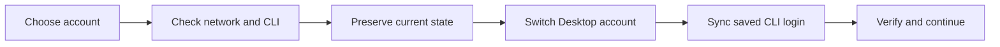

<div align="center">


# Claude Switcher

### Change accounts without losing your place.

A quiet macOS menu bar companion for Claude Desktop and Claude Code.<br>
Accounts, usage, sessions and network checks meet in one place.

[](https://github.com/liuquanqing/claude-switcher/releases)
[](https://github.com/liuquanqing/claude-switcher/releases)
[](LICENSE)
[](https://github.com/liuquanqing/claude-switcher/actions/workflows/ci.yml)

[](https://github.com/liuquanqing/claude-switcher/releases/download/v1.3.0/ClaudeSwitcher-1.3.0-arm64.dmg)

**1.3.0** · Apple Silicon · macOS 13+

[Download](#download) · [Features](#features) · [Quick start](#quick-start) · [Scope](#scope) · [中文](README.md)

</div>

<p align="center">
  
</p>

> Claude Switcher is an unofficial community project and is not affiliated with Anthropic.<br>
> It continues from [l2succes/claude-switcher](https://github.com/l2succes/claude-switcher). See [CREDITS.md](CREDITS.md).

## A quieter way to move between accounts

Multiple Claude accounts often mean repeated sign-ins and a terminal that no longer shares the same working identity as Desktop.

Claude Switcher keeps that work in the menu bar: see the current account, check the conditions before a move, and let Desktop and the saved default CLI login stay in step.

## Features

| | |
| --- | --- |
| **Account switching** | Keep separate Claude Desktop data directories for different working identities. |
| **Desktop + CLI** | Synchronize the saved default OAuth login used by Claude Code. |
| **Preflight** | Inspect the proxy, TUN interface, Claude domains and expected region before changing accounts. |
| **Background guard** | Observe explicitly confirmed subscription desktops while the panel is closed. |
| **Session import** | Import, append, back up, undo and restore supported local desktop session indexes. |
| **Config awareness** | Detect Magpie and CC Switch configuration sources without taking over their secrets or exit flow. |
| **Usage at a glance** | Show account usage windows and reset times without adding another dashboard. |

## Switch flow



Known failures, unknown states and unresolved conflicts stop the operation before account data is moved.

## Screens

<table>
<tr>
<td align="center" width="50%">
<br>
Accounts and usage
</td>
<td align="center" width="50%">
<br>
Network and protection
</td>
</tr>
</table>

All account details in these screenshots are fictional.

## Download

Version 1.3.0 includes the latest API manager detection and CLI status refinements. The app is now named **Claude Switcher**, without the candidate suffix. See [release notes](docs/releases/1.3.0.md).

**[Download Claude Switcher 1.3.0 · macOS DMG](https://github.com/liuquanqing/claude-switcher/releases/download/v1.3.0/ClaudeSwitcher-1.3.0-arm64.dmg)**

For **Apple Silicon (M1 or newer) · macOS 13+**. Open the DMG and drag `Claude Switcher.app` to Applications.

[Release notes](https://github.com/liuquanqing/claude-switcher/releases/tag/v1.3.0) · [SHA256 checksums](https://github.com/liuquanqing/claude-switcher/releases/download/v1.3.0/SHA256SUMS) · [All releases](https://github.com/liuquanqing/claude-switcher/releases)

The build uses an ad-hoc local signature and is not notarized by Apple. See [the installation guide](docs/INSTALL.md).

## Quick start

1. Download and verify the archive.
2. Move `Claude Switcher.app` to Applications.
3. If macOS blocks the app, use Open Anyway in System Settings → Privacy & Security for this app. See [the first-launch guide](docs/INSTALL.md#3-首次打开).
4. Add an account, or switch to an empty account and sign in through Claude.
5. If you want background protection, confirm the region, proxy mode and desktop scope in Settings.

Keep only one Claude account manager active. This release and the original Claude Switcher share the same account directories.

## FAQ

<details>
<summary><strong>Does switching an account rewrite cloud conversations?</strong></summary>

No. Claude Switcher changes the active account by rotating local Claude Desktop data directories. Supported local session imports remain local indexes, not a cloud migration.

</details>

<details>
<summary><strong>Why might an already-running CLI task keep the previous identity?</strong></summary>

Claude Switcher synchronizes the saved default CLI login. A running task may continue with the credentials it obtained at startup, and the switcher does not force that task to stop.

</details>

<details>
<summary><strong>Which network modes are supported today?</strong></summary>

The current release supports Shadowrocket connection status and TUN interfaces in Automatic mode. Protected launch and switching stop when the proxy, TUN interface or expected region cannot be confirmed.

</details>

<details>
<summary><strong>Can it coexist with the original Claude Switcher?</strong></summary>

Rename or back up the original first to avoid replacing an app with the same filename. Both share the same account directories. Do not switch accounts in both apps at once or run two guards together.

</details>

## Scope

This release operates as a **switch gate and periodic observer**, alongside host-level network controls. Network isolation and immediate enforcement are still under separate validation and are not part of this release.

- Only the saved default CLI login is synchronized; running tasks are not guaranteed to change identity immediately.
- API-mode and unknown-mode desktops are not enrolled automatically.
- Session import supports adapted local desktop indexes, not complete cloud chat migration.
- The background guard checks approximately every 10 seconds, so it cannot observe every event between checks.

## Validation

The public source currently passes 176 Core tests, 121 isolated controller checks, and a release build plus signature verification.

See [VALIDATION.md](docs/VALIDATION.md) and the [GitHub Actions workflow](https://github.com/liuquanqing/claude-switcher/actions/workflows/ci.yml).

## Build from source

Requires Xcode command-line tools with Swift 5.9 or later.

```bash
./build.sh
./build.sh test
scripts/package-release.sh
```

Contributors should read [AGENTS.md](AGENTS.md). Tests must use fictional data and temporary directories.

## Credits and license

With thanks to [Luc Succes](https://github.com/l2succes) and [l2succes/claude-switcher](https://github.com/l2succes/claude-switcher), plus the account-management and configuration-interoperability ideas shared by XueshiQiao/CCSwitcher, YOURSJEYO/claude-switcher, Magpie and CC Switch.

See [CREDITS.md](CREDITS.md) and [LICENSE](LICENSE).

<div align="center">

**Claude Switcher**<br>
Switch lightly. Keep working.

</div>
