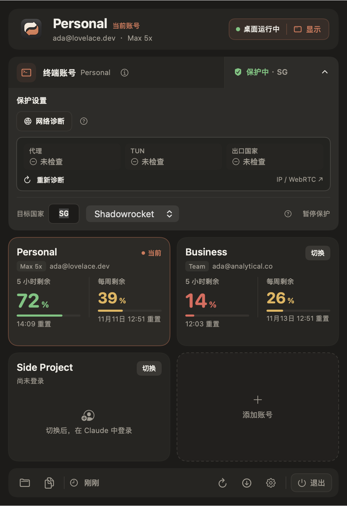
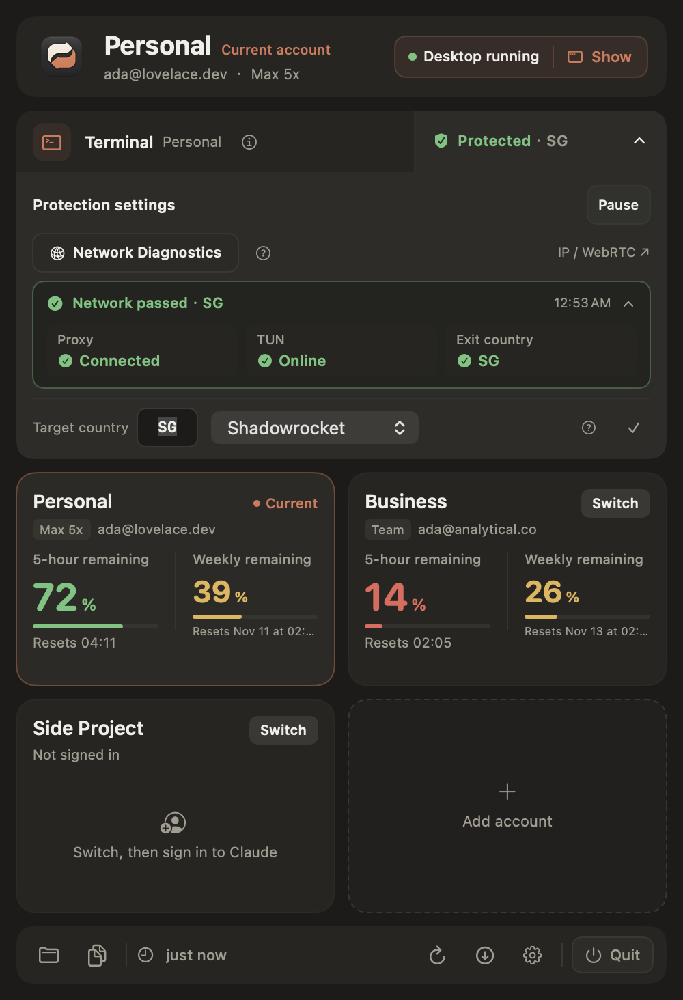

<div align="center">


# Claude Switcher

### 让每一次切换，都保留手上的工作。

为 Claude Desktop 与 Claude Code 打造的 macOS 菜单栏伙伴。<br>
账号、额度、会话与网络状态，在一个安静的入口里衔接起来。

[](https://github.com/liuquanqing/claude-switcher/releases)
[](https://github.com/liuquanqing/claude-switcher/releases)
[](LICENSE)
[](https://github.com/liuquanqing/claude-switcher/actions/workflows/ci.yml)

[](https://github.com/liuquanqing/claude-switcher/releases/download/v1.3.6-rc.8/ClaudeSwitcher-1.3.6-rc.8-arm64-developer-id-preview.dmg)

**1.3.6 RC8 · 预览版** · Apple Silicon · macOS 13+

[下载](#下载) · [核心能力](#核心能力) · [快速开始](#快速开始) · [边界与验证](#边界与验证) · [English](README.en.md)

</div>

<p align="center">
  
</p>

> Claude Switcher 是社区维护的非官方工具，与 Anthropic 没有隶属关系。<br>
> 项目基于 [l2succes/claude-switcher](https://github.com/l2succes/claude-switcher) 继续维护，原作者与许可证信息见 [CREDITS.md](CREDITS.md)。

## 为什么是 Claude Switcher？

多个 Claude 账号，通常意味着不断登录、退出、再找回终端里的工作身份。Claude Switcher 把这些重复动作收进菜单栏，同时让切换过程更可解释：先看见当前状态，再决定下一步。

它关注三件事：

- **少打断**：账号状态和 Claude Code 已产生的额度缓存自动更新；没有新数据时保留原采样时间。
- **保持一致**：桌面档案可配合专用的 Claude Code 目录；也可手动同步默认登录。
- **有依据**：启动与切号前检查代理、TUN 和目标地区；无法确认时停在原地。

## 核心能力

<table>
<tr>
<td width="50%" valign="top">

**在账号之间从容切换**

为不同工作身份保留独立的 Claude Desktop 数据目录，用更短的路径完成切换。

</td>
<td width="50%" valign="top">

**桌面与 CLI 一起对齐**

桌面切换保留默认 CLI 登录。可复制当前档案的独立目录命令，或显式确认同步默认 CLI。[使用说明](docs/design/cli-directory-link/README.md)

</td>
</tr>
<tr>
<td valign="top">

**切换前先确认**

检查代理、TUN、Claude 相关域名与目标地区。失败、未知或路由不一致时不继续。

</td>
<td valign="top">

**后台继续观察**

独立守卫管理明确确认过的订阅桌面；关闭面板后，保护设置仍由你决定是否保留。

</td>
</tr>
<tr>
<td valign="top">

**把会话带到下一站**

为适配的桌面会话提供复制、增量更新、备份、撤销与恢复，默认只处理可核验的本地索引。

</td>
<td valign="top">

**和现有工具共处**

识别 Magpie、CC Switch 写入的配置来源，提供跳转入口，不改写它们的密钥或退出流程。

</td>
</tr>
</table>

## 一次切换，几步完成


只有当检查结果明确通过，流程才会继续。API 模式、未知桌面模式、无法确认的 CLI 存储或冲突中的会话，都会停在原状态，等待你处理。

## 界面

从底部设置菜单切换全局中文与 English；检查更新与登录时启动也收在这里。账号名称、会话内容和路径保留原样。

<table>
<tr>
<td align="center" width="50%">
<br>
中文
</td>
<td align="center" width="50%">
<br>
English
</td>
</tr>
</table>

界面截图均使用虚构账号与演示数据。[保护设置与复制流程](docs/GLOBAL-LANGUAGE.md#验证记录)也经过双语复核。

## 下载

1.3.6 RC8 精简终端账号与 API 状态，切号后自动读取对应记录和官方额度缓存。详见[本版说明](docs/releases/1.3.6-rc.8.md)。

**[下载 Claude Switcher 1.3.6 RC8 · macOS DMG](https://github.com/liuquanqing/claude-switcher/releases/download/v1.3.6-rc.8/ClaudeSwitcher-1.3.6-rc.8-arm64-developer-id-preview.dmg)**

适用于 **Apple Silicon（M1 及更新芯片）· macOS 13+**。打开 DMG，将预览应用拖入“应用程序”。启用独立守卫的旧版本请先阅读升级说明，保留它使用的运行组件。

[版本说明](https://github.com/liuquanqing/claude-switcher/releases/tag/v1.3.6-rc.8) · [SHA256 校验文件](https://github.com/liuquanqing/claude-switcher/releases/download/v1.3.6-rc.8/SHA256SUMS) · [所有版本](https://github.com/liuquanqing/claude-switcher/releases)

> 本预览版使用 Developer ID 签名并通过 Apple 公证，仍可能需要正常的首次打开及钥匙串授权。[1.3.5 正式版](https://github.com/liuquanqing/claude-switcher/releases/tag/v1.3.5)保留，签名状态以各版本说明为准。升级与卸载见[安装说明](docs/INSTALL.md)。

## 快速开始

1. 下载并校验安装包。
2. 将 `Claude Switcher Preview.app` 拖入“应用程序”，保留原版。
3. 按 macOS 提示完成首次打开；系统及钥匙串授权仍由 macOS 管理，详见[安装说明](docs/INSTALL.md)。
4. 添加账号，或切换到一个空账号后在 Claude 中完成登录。
5. 如需后台保护，在设置中确认目标地区、代理方式和桌面范围。

安装前建议只保留一个 Claude 账号管理器在运行。本版与原版 Claude Switcher 共享同一账号目录，不要同时切号。

## 常见问题

<details>
<summary><strong>切换账号会改写云端会话吗？</strong></summary>

不会。工具通过切换 Claude Desktop 的本地数据目录来改变当前账号；适用于复制的本地会话索引也不会被包装成云端迁移。

</details>

<details>
<summary><strong>为什么已经运行的 CLI 任务不一定立即换号？</strong></summary>

桌面切换不会改写默认 CLI 登录。专用命令只选择新启动会话的目录；手动同步默认登录时，已经启动的任务仍可能使用原身份。

</details>

<details>
<summary><strong>当前支持哪些网络检测方式？</strong></summary>

当前版本支持 Shadowrocket 连接状态，以及“自动”模式下的 TUN 网卡。无法确认代理、TUN 或目标地区时，切换和受保护启动会停止。

</details>

<details>
<summary><strong>可以和原版 Claude Switcher 同时安装吗？</strong></summary>

保留原版前请先将它改名或备份，避免拖入时被同名替换。两者共享同一账号目录。请不要同时打开两个管理器切号，也不要同时启用两套守卫。

</details>

## 边界与验证

Claude Switcher 的定位是**切换门禁与周期性状态观察**，与系统级网络策略互补。网络层隔离与即时阻断仍在独立验证中，尚未接入本版。

网络检查、CLI 同步和会话复制都以可确认的边界为前提：

- 默认 CLI 登录只在明确确认兼容同步时才会被改写。专用目录中的登录由官方 CLI 管理。
- API 或未知模式的桌面不会自动纳入订阅保护。
- 会话复制面向已适配的桌面索引，不等同于完整云端聊天迁移。
- 后台守卫约每 10 秒检查一次，不能覆盖两次检查之间的全部变化。

当前公开发布源码已通过：

- Core 测试：176 项
- 控制器隔离检查：147 项
- release 构建与 ad-hoc 签名验证

[查看完整验证范围](docs/VALIDATION.md) · [查看最新云端 CI](https://github.com/liuquanqing/claude-switcher/actions/workflows/ci.yml)

## 从源码构建

需要 Xcode 命令行工具（Swift 5.9+）。

```bash
./build.sh          # 构建，不会自动安装或注册服务
./build.sh test     # 运行核心测试
scripts/package-release.sh
```

开发与贡献请先阅读 [AGENTS.md](AGENTS.md)。自动化测试只能使用虚构数据与临时目录，不要使用真实登录、Keychain、账号目录或会话。

## 致谢

感谢 [Luc Succes](https://github.com/l2succes) 创立的 [l2succes/claude-switcher](https://github.com/l2succes/claude-switcher)，它为桌面账号切换、会话复制和 CLI 登录同步提供了基础。

也感谢 [XueshiQiao/CCSwitcher](https://github.com/XueshiQiao/CCSwitcher)、[YOURSJEYO/claude-switcher](https://github.com/YOURSJEYO/claude-switcher)、[Magpie](https://github.com/yetone/magpie) 与 [CC Switch](https://github.com/farion1231/cc-switch) 在账号管理、启动检查和配置互操作方面带来的启发。

完整贡献与许可证说明见 [CREDITS.md](CREDITS.md) 与 [LICENSE](LICENSE)。

<div align="center">

**Claude Switcher**<br>
Switch lightly. Keep working.

</div>
