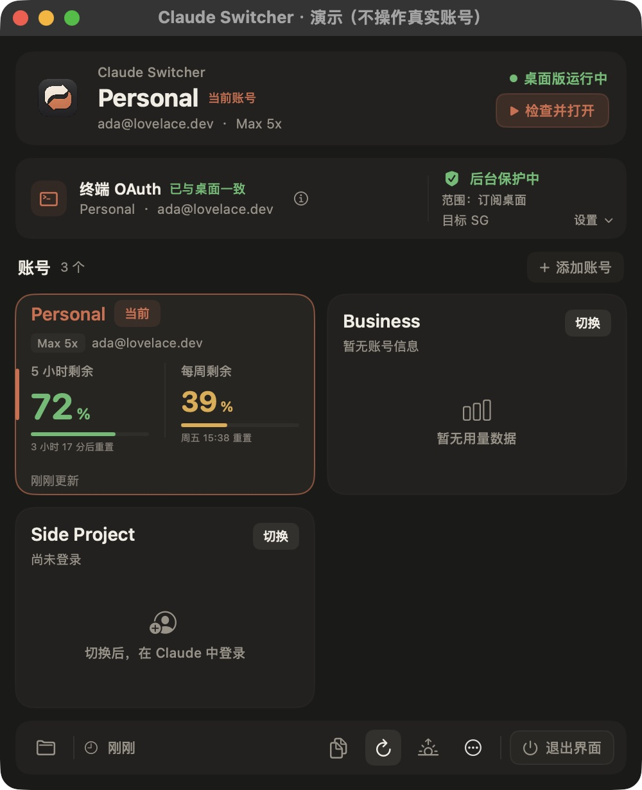

# Claude Switcher · 本地维护版

一个菜单栏应用管理 Claude 桌面账号、终端登录同步和网络地区守护。基于 [l2succes/claude-switcher](https://github.com/l2succes/claude-switcher) 的 MIT 代码开发；上游说明保存在 [UPSTREAM-README](docs/UPSTREAM-README.md)。

当前 `v1.3.0-local.6`（内部构建 `20261028.6.3`）已更新到 `/Applications/Claude Switcher 候选版.app`，未自动启动；**原版保留，账号和真实会话未操作，也未交接守卫**。新增迁移能力只用独立临时虚构目录验收，真实会话未读写。守卫/急停仍按用户要求仅做隔离仿真，不安排真实账号故障注入。

[打开离线功能对比说明](docs/功能对比说明.html)：与桌面原版、CCSwitcher、检查型切换器及 API 管理器的功能和边界对照。



*截图使用虚构账号，不代表已部署保护。*

原生演示窗口与展开区：[默认窗口](docs/window-local5.jpg)、[保护设置](docs/settings-local5.jpg)。窗口按内容调整高度，较长说明可在窗口内滚动。[API 配置状态预览](docs/api-local5.jpg)。

原有融合由Kimi CLI完成；本轮Kimi周额度耗尽后，经用户授权由本机官方Claude CLI继续，统一紧凑卡高、将添加入口移至标题旁、导入语言收进页脚偏好，保留双列账号布局与明确退出按钮。底部不再常驻保护提示；保护开关和检测说明放在设置中。主代理负责后端与评审。设置采用紧凑参数行和按需内联帮助；无改动时保存弱化，API 来源置于底部。

保护摘要与终端状态共用一张卡片，启动入口放在当前账号摘要右侧。正常时不显示终端同步按钮；只有两边不一致时才提供补救操作。终端跟随切换只恢复已保存的 OAuth 登录，每个账号首次使用终端仍需单独登录，不会从桌面凭据生成终端登录。

[候选安装与验证策略](docs/候选安装与验证策略.md) · [会话迁移方案草案](docs/会话迁移方案.md) · [可点击交互稿（虚构数据）](docs/prototypes/session-transfer.html)

## 本轮功能

- 桌面账号切换与终端凭据同步，保留原来的用量面板。
- 打开、切换前检查代理、TUN 和出口国家；未知也不放行。完成切换后，打开 Claude 前再检查一次。
- 用户级独立守卫每 10 秒执行一次。网络异常时，只关闭本入口启动或用户明确确认的订阅桌面；退出界面后仍继续运行。
- 明确区分“退出界面，保留后台保护”和“停止保护”。不会自动更改系统语言、时区、IPv6 或代理规则。
- 对已支持的默认Keychain或默认文件存储，正常切号同时同步已保存CLI登录；先核验、保存备份，再退出和移动桌面。CLI 提交失败尝试还原两端，不能确认恢复时明确停止。
- 默认文件凭据已接入备份/同步；冲突、拒绝读取或来源未知时停止。手动检查不写认证，不一致时才确认同步；目标无备份保留当前登录。
- CLI 准备失败时可由用户明确选择仅切桌面，保留 CLI 原登录；后台检测不一致只提示，提供核验后的同步入口，不停止运行中的 CLI 任务。
- 按生效配置标记匹配 Magpie / CC Switch，并打开原工具。退出 API 接管在原工具的模式或提供方设置中完成，仅退出管理器应用不代表解除接管。

**会话导入（原复制功能）已接入原生窗口。** 默认勾选缺少项、跳过已有；同段增量显式开启，更新才确认；自动备份、撤销、恢复和返回账号面板均用虚构数据测试。额外提供单击“复制指令”本地请求和命令入口，复用同一引擎。不同 CLI 段自动接续仍拒绝；只迁移已适配的桌面索引，不写 `~/.claude/projects` 原文，不能当作完整聊天数据备份。

[迁移实现与验证](docs/会话迁移实现进度.md) · [备用命令说明](docs/会话复制备用命令.md) · [原生截图](docs/prototypes/local6-import-refined.png)

## 构建与测试

需要 macOS 13+、Swift/Xcode 命令行工具。本地验证使用临时目录、假网络和假进程动作，不使用真实账号或钥匙串。

```sh
swift test
scripts/test-controller.sh
./build.sh
```

产物：`build/Claude Switcher.app`，包含 `Contents/Helpers/ClaudeGuard`。构建不会安装 App、注册登录项或启动守卫。

应用图标选用 `assets/icon-candidates/switcher-flow-v6.png`。`scripts/build-icon.sh` 使用系统工具生成各尺寸及 ICNS，构建时同时打包面板图标；生成不依赖在线服务。原始生成说明保存在同目录的 `.prompt.txt`。

```sh
./build.sh dmg       # 当前架构 DMG，输出到 dist/
./build.sh install   # 明确安装；要求先退出 Claude 和旧切换器，保留原 App 备份
```

安装前请先读 [安装与迁移](docs/安装与迁移.md)，尤其是已安装旧保镖的机器。

## 保护边界

目标国家由用户保存，例如 `SG`。当前支持 Shadowrocket VPN 与 `198.18.*` TUN 识别；“自动识别 TUN”仅检查同类 TUN。国家通过 claude.ai、api.anthropic.com、claude.com 三个域名的无认证 HTTPS trace 并行确认，彼此不一致、超时、错误响应或字段不明确时拒绝启动。

这是**启动门禁和进程急停**，不是防火墙。轮询间隔、网络探测和终止过程存在延迟；从 Finder 直接打开 Claude 也不经过启动门禁。三个主要域名的探测仍不能证明所有子域和每条连接采用同一出口，仍需代理路由正确。

后台急停只针对 Claude 桌面客户端；终端凭据同步不代表任意终端或 IDE 中的 Claude Code 进程也受急停保护。配置与回执只保存必要状态，不记录公网 IP、代理地址、账号或会话内容。

“Claude 运行中”只表示发现桌面客户端进程，不表示已经登录、聊天可用或网络已验证。HTTPS 国家探测由切换器自身发起，不检查桌面客户端的全部实际连接；假数据预览中的运行状态为预设值。

API/未知配置和外部启动的未确认进程不自动纳入守护。订阅进程的 PID、启动时间和配置代次必须匹配；配置被重写后需重新确认，即使看起来仍是订阅模式。这是保守边界，不证明运行进程实际采用了何种认证或路由。真实 1P/3P 往返仍待验收。

CLI 核验针对默认保存登录；菜单栏应用无法观察每个 shell 的环境变量、项目设置或已运行任务的凭据缓存。不直接刷新 OAuth，不把桌面登录转换为 CLI 登录。未验证的旧过期备份保留，首次使用或失效时由用户在官方 CLI 登录。

## 文档

- [账号存储、3P 与迁移方案分析](docs/存储与迁移方案分析.md)
- [CCSwitcher 的 CLI 登录保存与权限比较](docs/CLI登录保存方案调研.md)
- [Claude 独立审查与索引重置案例](research/R-20261027-003-improvement-review.md)
- [整合设计与验收边界](docs/整合设计.md)
- [开发与验证](docs/开发与验证.md)
- [安装、旧守卫迁移和停止保护](docs/安装与迁移.md)

GitLab 私有仓库：[liuquanqing/claude-switcher](https://git.touchturing.com/liuquanqing/claude-switcher)。`origin` 指向该仓库，`main` 保存维护版主线，`codex/network-region-guard` 为当前开发分支；原版来源仍保留为 GitHub `upstream`，不向上游推送。

## License

MIT，保留上游 LICENSE。

本轮补丁与安装、只读登录诊断、守卫尚未交接的状态见[当前试用记录](docs/当前试用问题与交接状态.md)。

[CLI文件凭据与备份同步](docs/CLI文件凭据备份与同步.md) · [检查/同步交互](docs/CLI检查同步交互.md) · [本轮假数据验证](docs/prototypes/local6-cli-file-validation.json)。
