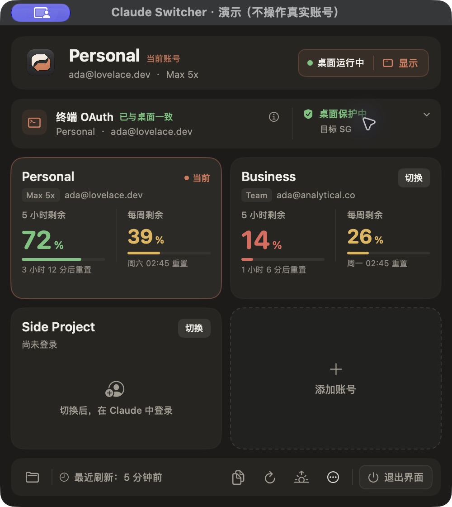

# Claude Switcher（社区维护版）

macOS 菜单栏工具，用于在多个 Claude 订阅账号之间切换 Claude Desktop 与 Claude Code CLI 的登录状态。

> **非官方项目。** 本项目与 Anthropic 无关，未获 Anthropic 认可或支持。“Claude”是 Anthropic 的商标，此处仅用于说明兼容对象。
>
> 本仓库是 [l2succes/claude-switcher](https://github.com/l2succes/claude-switcher)（作者 Luc Succes，MIT 许可）的公开 Fork，由社区维护。上游基线为 `main` 分支的提交 `011c00797c083530dc8cfa4557416cece86ab2b1`。原作者的版权与许可证保留在 [LICENSE](LICENSE) 中，致谢见 [CREDITS.md](CREDITS.md)。


## 当前版本

`v1.3.0-local.6`（内部构建 `20261029.6.7`），**预发布**。

- 预编译包仅支持 **Apple Silicon（arm64）**、**macOS 13 及以上**。Intel 和 universal 构建都没有在真机上验收过。
- App 只有 ad-hoc 本地签名，**没有 Developer ID 签名，也没有经过 Apple 公证**。
- 发布说明见 [docs/RELEASE-v1.3.0-local.6.md](docs/RELEASE-v1.3.0-local.6.md)。

## 功能

### 继承自上游

- 菜单栏面板：列出已保存的 Claude Desktop 账号并一键切换。
- 在账号之间复制 Claude Code 会话的窗口。
- 切换桌面账号时同步切换终端里 `claude` CLI 的登录。

### 本维护版新增或修改

- **切换前网络门禁**：轮换桌面账号目录之前，先检查代理/TUN 是否在线，再分别向 `claude.ai`、`api.anthropic.com`、`claude.com` 发请求，观察出口国家，要求结果与设定的目标国家一致。结果失败、未知或各域名不一致时，一律不放行。
- **CLI 身份与备份核验**：切换前先核验 CLI 当前的身份，并确认备份可用。备份失败会在退出或移动桌面目录之前被发现。
- **最小范围写入 CLI 凭据**：在默认 Keychain 项或 `.credentials.json` 中，只改写本工具自己管理的 OAuth 字段。遇到冲突、拒绝读取或格式未知时会停下，不会覆盖。写入失败时先回读，必要时还原。
- **独立守卫**：一个用户级 LaunchAgent（`dev.claudeswitcher.guard`），大约每 10 秒复查一次网络。它只管理通过本工具打开的桌面，或者你明确确认过的订阅模式桌面。关闭面板或界面不会停止守卫，需要在设置里主动关闭保护。
- **CLI 边界**：只核验和同步“默认保存的登录”，不会强行停止正在运行的 CLI 任务，也不保证已在运行的旧任务会立刻换成新账号。
- **API/未知模式**：桌面处于 API 模式或模式无法确认时，不会被自动纳入订阅保护。
- **配置互操作**：能识别 Magpie、CC Switch 写入的配置来源，并提供跳转到原工具的入口。本工具不管理这些工具的密钥，也不接管它们的退出流程。
- **会话导入**（仅限已适配的桌面索引格式）：会话原文共享、不改写。默认只新增，同一段会话能验证时才做增量追加，支持备份、撤销和恢复。它**不是**完整的云端聊天迁移，也**不能**让一段会话自动接续到另一个 CLI 账号的会话里。
- **静默刷新**：打开面板时只读取本地状态。启动时、每 5 分钟一次、以及手动刷新时会联网，结果全部完成后才一次性更新界面，检查过程中不会先降级显示。核验入口在 ⓘ 里，强门禁规则不变。




## 使用前请了解

- 网络探测只是本程序对几个主要域名的观察结果。它**不是防火墙**，也不能证明 Claude 客户端的每一条连接都走同一个出口。守卫约每 10 秒检查一次，不是实时的。
- 本工具不保证账号安全，不能防止封号，也不保证所有情况都能恢复。请自行承担使用风险，并遵守 Anthropic 的服务条款。
- 候选版与原版 Claude Switcher **共享同一个账号目录**。不要用两个管理器同时切号。
- 只支持文中列出的代理检测方式：Shadowrocket 连接状态，或“自动”模式下的 TUN 网卡。其他网络环境可能无法通过门禁，这是预期行为。

## 安装

从 GitHub Release 下载 DMG 或 ZIP，校验 SHA256，然后把 `Claude Switcher 候选版.app` 拖进“应用程序”文件夹。完整步骤、首次打开方式和卸载方法见 [docs/INSTALL.md](docs/INSTALL.md)。

## 从源码构建

需要 Xcode 命令行工具（Swift 5.9+）。

```bash
./build.sh          # 只构建，产物在 build/，不会安装或注册任何服务
./build.sh test     # 运行 swift test
```

`./build.sh` 产出候选版（Bundle ID `dev.claudeswitcher.candidate`），默认不覆盖原版。运行 `scripts/package-release.sh` 可构建并生成当前架构的 DMG、ZIP 和 SHA256SUMS。不要从 `build/` 目录直接长期运行：守卫记录的是 helper 的路径，临时目录不适合做长期路径。

测试范围与尚未验证的场景见 [docs/VALIDATION.md](docs/VALIDATION.md)。贡献代码时请遵循 [AGENTS.md](AGENTS.md)：只用虚构数据和临时目录，切勿拿真实登录、Keychain 或会话当测试数据。

## 许可证

MIT，见 [LICENSE](LICENSE)。原始版权 © 2026 Luc Succes。本维护版的修改同样以 MIT 许可发布。
