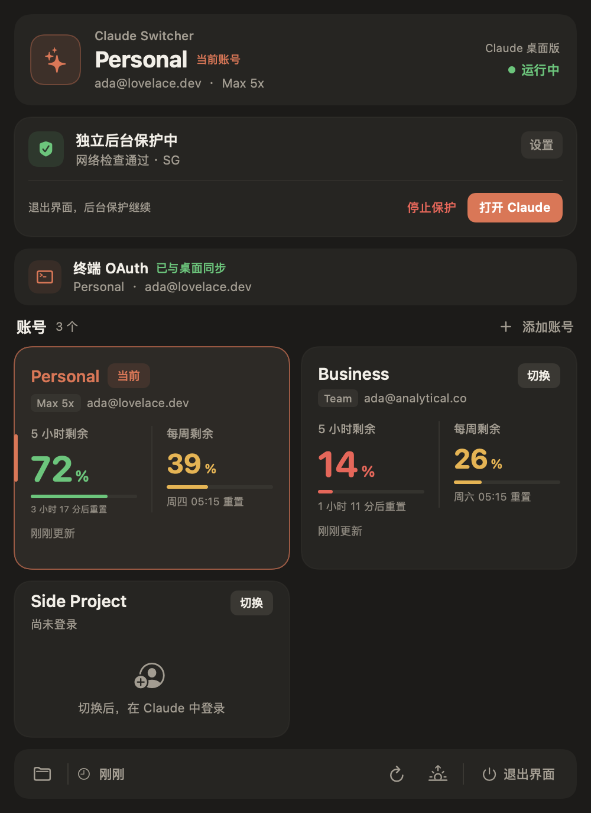

# Claude Switcher UI 设计

状态：本轮界面实现；不代表真实账号、网络或后台守卫已经验收。

## 设计目标

这是一个高密度、短停留的 macOS 菜单栏工具，而不是安全宣传页。界面延续上游的暖深色背景、卡片和 Claude 橙色强调，减少 oversized 数字、重复胶囊、全大写英文和无信息量的空卡。

优先级依次为：当前账号与运行状态、后台保护是否可用、终端同步状态、各账号用量与切换操作。界面不新增任何保护判断，也不把未知状态描述成安全。

## 面板结构

面板宽 500 pt，外边距 12 pt，主要间距 10 pt。

1. **当前账号摘要**：42 pt 图标、账号名、邮箱/套餐，以及 Claude 桌面版运行状态。当前账号不使用巨大的 “is live” 标题。
2. **保护条**：默认只展开状态摘要和底部操作；已启用时可通过“设置”展开配置。未启用时直接显示配置和启用入口。
3. **终端条**：显示“已与桌面同步”“与桌面不同”或“账号待确认”，保留同步到当前账号的操作。
4. **账号区**：双列卡片，标题旁显示账号数量并提供轻量添加按钮。添加时使用内联输入行，不再放置大型虚线空卡。超过四个账号时，网格限制为两行高度并滚动，其余操作保持可见。
5. **底部工具条**：账号目录、上次刷新、手动刷新、登录时打开，以及带文字的“退出界面”。

全局错误仍通过原有 `Store.banner` 展示；界面不吞掉部分完成、启动门禁或终端同步错误。

## 账号卡

有用量数据的卡片高度约 188 pt，未登录或加载中的卡片约 132 pt，圆角 14 pt。当前账号仅以橙色名称、细描边、短 accent 和“当前”标记强调，其他账号保留明确的“切换”按钮。

用量区并列显示：

- 5 小时剩余：主数字、3 pt 进度条、中文倒计时重置时间。
- 每周剩余：次级数字、3 pt 进度条、本地中文星期与时间。
- 数据状态：读取错误使用警示色并保留悬停全文；非实时快照明确标为“缓存”。未知用量保持 `--`，不绘制为满额或通过。

时间文案统一为自然中文，例如“3 小时 18 分后重置”“周三 21:54 重置”“5 分钟前更新”。

## 保护状态与设置

`ProtectionStrip(controller:busy:openClaude:)` 签名保持不变。所有启停、预检和状态文字仍来自 `ProtectionController`。

| 界面条件 | 标题与颜色 | 含义 |
|---|---|---|
| `enabled && lastDecision.allowed` | “独立后台保护中”，通过色 | 原控制器最近判断允许；不额外扩大结论 |
| 已启用但不允许 | “保护需要检查”，警示色 | 包括失败、未知、回执过期等，不显示为安全 |
| 未启用 | “后台保护未启用”，中性色 | 需要配置并启用，启动仍由原门禁拦截 |
| `working` | “正在更新保护设置”，中性色 | 操作进行中，相关控件暂时禁用 |

设置项包括两位出口国家代码和代理模式。默认国家仍由控制器提供为 SG；界面不会根据本次出口自动改目标。Shadowrocket 与自动模式都明确说明当前只识别 `198.18.*` TUN 地址。

“打开 Claude”仍调用原 `openProtectedClaude()`，由 Store 在打开前检查代理、TUN、出口国家和守卫状态。“保存并启用”仍调用 `controller.enable()`。

## 退出与停止是两种动作

- 底部“退出界面”只调用 `NSApp.terminate`。悬停说明根据当前状态解释后台行为；忙碌或保护设置更新时禁用。
- 已启用时，保护条显示“退出界面，后台保护继续”。未启用时只说不改变保护状态，不暗示已有守卫。
- “停止保护”只出现在保护条，必须再经确认对话框，然后才调用 `controller.disable()`。
- 界面没有通过隐藏、关闭窗口或退出按钮间接停止后台守卫的路径。

## 会话迁移延期边界

`Store.sessionMigrationEnabled` 当前固定为 `false`。本轮主面板没有会话复制入口，也不提供可绕过该状态的产品操作。

`CopyThreadsView` / `CopyWindow` 暂留为后续原型，不属于本轮产品导航。既有 `--copy` 演示渲染不能作为迁移能力或验收证据。

后续必须先回查订阅 ↔ 订阅、订阅 ↔ API 的既有迁移脚本，核对账号与组织身份、共享 transcript 和模式差异。会话索引复制不等于完整数据迁移；本轮不宣称该功能已修复或可用。

## 视觉约定

- 背景 `#1C1B19`，卡片 `#262522`，当前卡 `#2D2A26`；边框保持低对比。
- 正文 `#F2EFE8`，次级文字 `#A39D92`，当前账号与主要操作使用 `#D97757`。
- 绿色只用于已经通过的检查、同步状态或充足用量；未知保护状态不得使用绿色。
- 正文以 10.5–14 pt 为主，账号名 19 pt，主要剩余量 30 pt；不再使用大面积全大写重字距标签。

## 验证与交接

本轮实际结果：`swift build` 通过；`swift test` 共 34 项测试，0 失败；默认主面板通过 `--demo --snapshot` 渲染并读取检查，逻辑尺寸约 500 × 687 pt。演示只使用虚构账号，不接触真实钥匙串、账号、代理配置或守卫注册。

未执行真实应用、真实启停、真实账号或网络测试。展开保护设置、停止确认、添加账号和超过四个账号的滚动仍需主代理在统一交互验收中检查，不能由静态渲染推定通过。

主代理还需统一审查：真实启动/切换门禁、LaunchAgent 注册与新鲜回执、停止/退出/卸载生命周期、实际代理和国家异常，以及迁移脚本核对。`App/main.swift` 当前使用“退出界面（保护状态不变）”的中性菜单文案，与面板的生命周期表达一致。

## 主代理统一复核

Kimi CLI 交接后，主代理完成同一 Panel 的独立演示窗口交互验收：设置展开、无效国家、停止确认/取消、停止后的退出提示同步、停止后阻止打开、恢复、添加虚构账号、12 账号滚动、国家不符时拒绝打开与切换、退出。预览使用固定的演示窗口，不访问真实账号。

集成修正：Panel 显式观察保护控制器，修复停止后底部退出提示不刷新；用量刷新期间不允许账号切换或终端同步；演示目录按钮不打开真实账号目录；终端明确标为 OAuth，不声称迁移 API 模式。未检测到 OAuth 时不用绿色显示“已同步”。主菜单退出使用“保护状态不变”的中性文案。

最终总测试为 39 项，包含 10 项延期原型测试；真实账号、正式守卫与真实菜单栏弹层锚点仍未验收。下图只含虚构账号：

