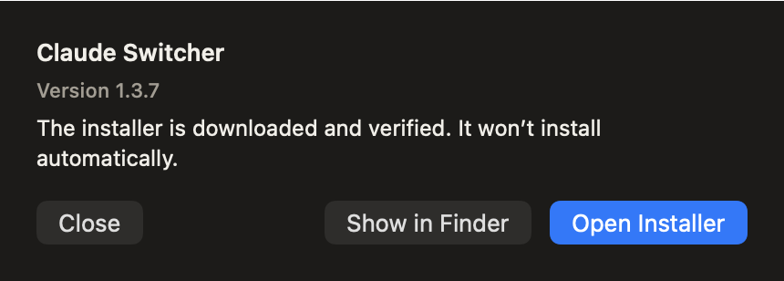

# 底栏、设置与更新检查

2026-11-04。本轮为本地候选修改，未替换已安装的 Preview、未发布新版本。前端及产品文案由 Kimi CLI 完成，Codex 负责窗口生命周期、更新呈现控制器和复核。

## 交互

1. **底栏**：账号目录在最左，随后是额度采样时间；复制、刷新、设置与退出保持右侧分组。账号目录不再重复放进设置。
2. **设置**：保留全局语言；“开机自启动”用菜单勾选，准确含义为登录 Mac 后启动切换器菜单栏进程，不会自动打开 Claude。未改登录项注册逻辑或现有设置。
3. **检查更新**：菜单直接检查，不先打开更新页面。重复点击合并，同正在进行的后台检查共用结果。无新版或失败仅在设置菜单显示中性状态，不覆盖账号切换或守护的警告。
4. **发现新版**：打开约 430 × 168 pt 的紧凑提示，显示版本、发布说明链接和“稍后／下载”。仅在用户操作时前置，不长期悬浮在其他应用之上。显示前会先收起主面板，避免菜单栏弹层遮挡更新框。图中 1.3.7 是虚构版本。
5. **下载后续**：下载中显示进度，可单独取消下载；关闭窗口继续下载。就绪后手动打开安装包或在 Finder 中显示。下载、大小与哈希检查、签名及安装包校验沿用原路径，没有自动安装。
6. **主面板收起**：补充本应用其他窗口点击、其他应用鼠标点击和失焦的关闭路径；同一面板及其子帮助窗口保持可交互。监听只在面板展开期间存在，关闭时移除。收起不终止账号任务、切换器进程或守卫。

## 截图（全部虚构）

这些是实际 SwiftUI 视图的隔离渲染，活动态控件颜色通过渲染环境指定；不是线上版本或真实账号的截图。

## 验证

- 完整应用构建通过；360 项控制器检查通过，覆盖菜单连点合并、无新版不打开窗口、错误反馈、共享在途检查、已有安装包保留及提交后状态读取。
- `scripts/test-popover.sh`：13 项虚构 AppKit 窗口生命周期检查通过；测试中关闭 AppKit 默认自动收起机制，单独验证新增关闭路径、面板内点击、锚点点击、子窗口、其他窗口及多次展开后失焦。
- 8 张中英文截图检查了主面板、发现新版、就绪和失败。更新提示内容高度约 137–185 pt；英文就绪按钮能够完整显示。
- 实际更新窗口使用虚构 updater 的 available → downloading → ready 变化，内容未被截断。
- 界面提供 Escape 关闭、Return 主操作快捷键；该键盘行为只经代码与构建检查，未完成原生键盘验收。
- 原生点击工具出现长时间无响应，未完成真实鼠标、键盘和 VoiceOver 验收；不能以生命周期检查代替完整原生交互验证。独立测试窗口程序已关闭。
- 未读取真实账号、钥匙串或会话作为测试数据；未执行真实更新下载、安装、授权或登录项注册；未改变现有网络和守卫。

## 依据与范围

Apple 的 [NSPopover](https://developer.apple.com/documentation/AppKit/NSPopover) 文档将 transient 定义为响应多数用户交互而关闭，因此仅设该行为不能作为所有时序均已验证的证据。[SMAppService.mainApp](https://developer.apple.com/documentation/servicemanagement/smappservice/mainapp) 对应主应用的登录项；本轮只修正文案，没有把它扩展为 Claude 自启动或守卫开关。
