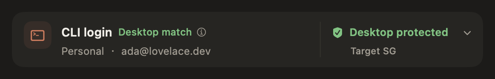

# 桌面纳管持续性与状态栏

普通配置被重新写入时，同一已确认的订阅桌面不应无故退出保护。原规则将两个文件的完整内容、文件身份和写入时间作为一个版本；即使只是普通配置的原子替换，也会导致纳管失效。

本补丁保留原版本检查，并增加一个有条件的延续规则：确认纳管或从本入口启动时，如果 `Claude` 的配置可读、没有声明 `deploymentMode`，而 `Claude-3p` 的配置明确为 `1p`，便记录后者的完整文件版本。后续只有该订阅标记仍有效、文件版本不变、当前模式仍明确为订阅且桌面进程身份相同时，普通配置保存才可延续既有纳管。应用不会写入这两份 Claude 配置。进程身份仍以 PID 和启动时间共同判定。

如果模式冲突、无法读取、独立标记消失或其文件发生变化，则不能走延续规则。即使从 API 切回后恢复原标记内容，文件版本也已改变，不能沿用原确认。缺少独立证据的安装继续用严格版本校验。守卫在观察到绑定证据失效后撤销原记录，不把该记录传给当次关闭操作。这一边界参考了 [Magpie 的桌面配置说明](https://github.com/yetone/magpie/blob/main/docs/subsystems/agent-wiring.md) 和 [CC Switch 的桌面模式说明](https://github.com/farion1231/cc-switch/blob/main/docs/user-manual/en/2-providers/2.6-claude-desktop.md)，不假定任意配置改写都是普通保存。

## App 与守卫同时生效

旧记录和旧守卫回报仍可读取。旧守卫仍执行严格版本检查；App 只有收到与现行配置一致、未过期的新守卫能力回报才使用延续规则。仅替换 App 不会让后台提前启用新规则，也不会显示基于该规则的绿灯。两边升级后，旧记录若没有独立标记，仍需一次新的确认。

本轮只交付源码候选和隔离验证。未替换已安装的 Preview，未停用、注册或启动真实守卫，未修改真实账号、会话、网络或纳管记录。

## 界面

Kimi 将正常状态改为单行“桌面保护中 · SG”，保留盾牌、整行点击展开和原有帮助。国家码降低强调。英文或内容不足以容纳时保留两行，异常状态不压缩。

## 验证范围

- 虚构配置覆盖：同内容重写、普通设置修改、API 往返、模式冲突、标记缺失和旧守卫回报；同 PID 但不同启动时间不能继承保护。
- 临时夹具验证：普通保存后，错误国家仍会让守卫请求关闭已纳管的测试对象。没有运行真实断网或关闭测试。
- 中英文正常和异常状态均用实际 SwiftUI 视图离屏渲染。没有把截图当作真实鼠标或守卫交接验收。
