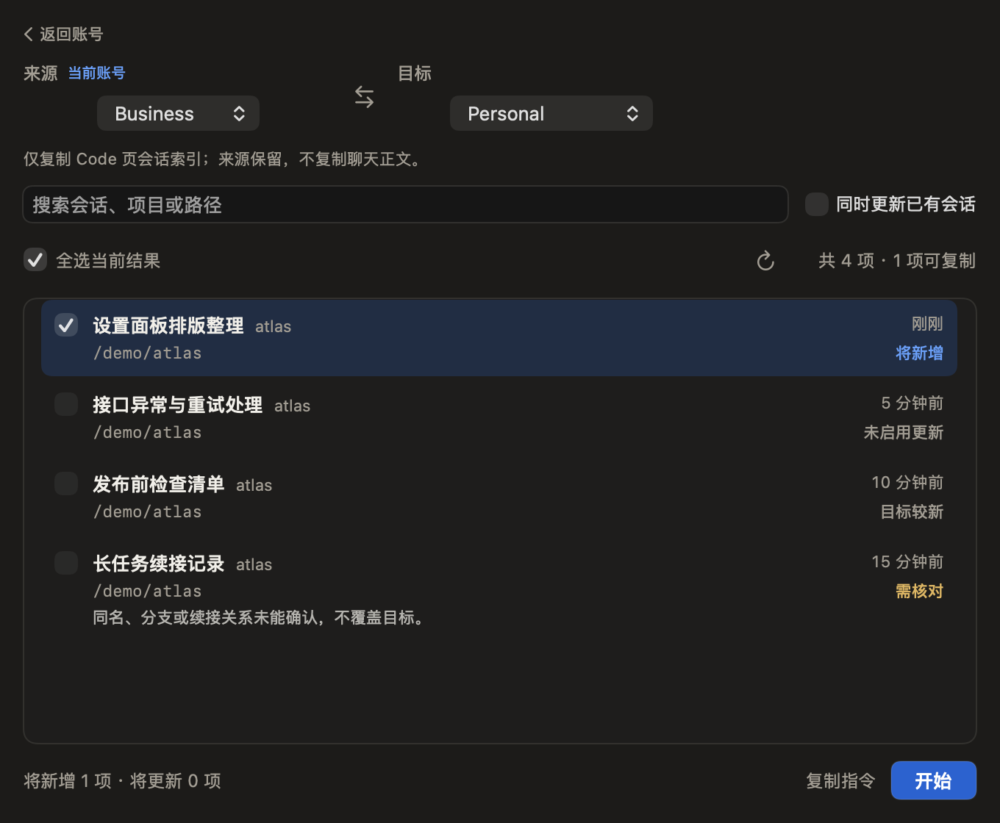
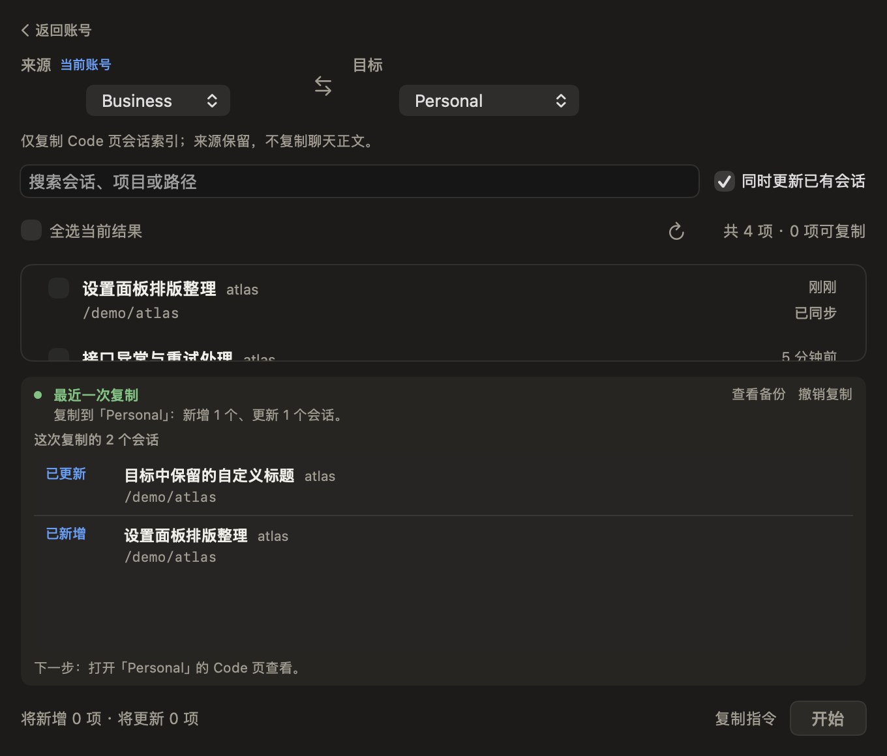
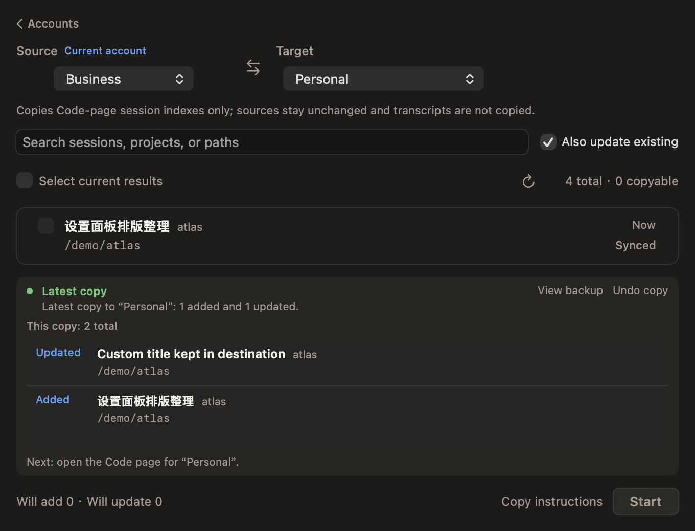
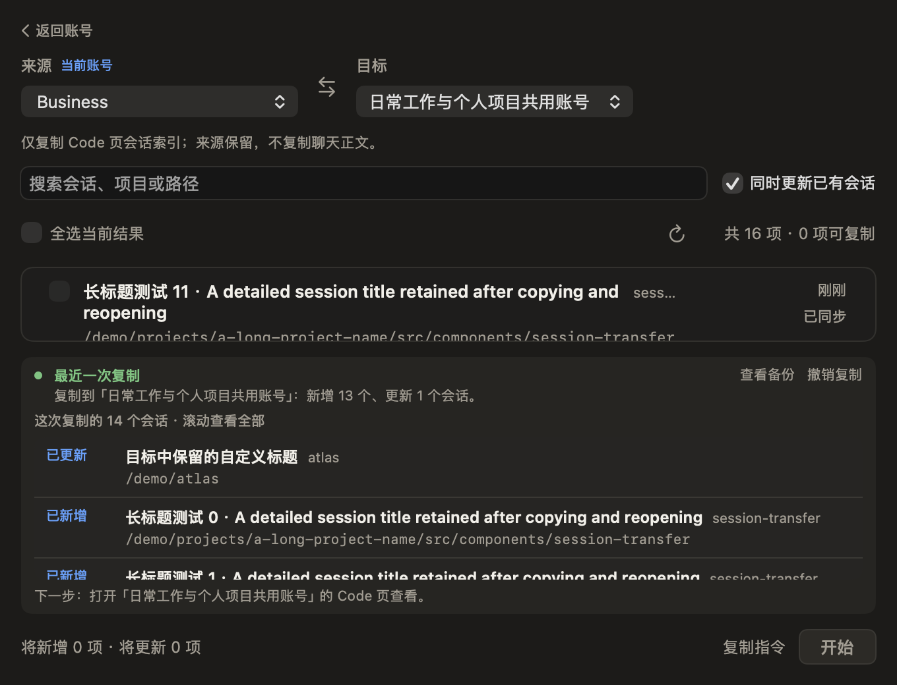

# 复制会话交互：保留具体会话与结果

2026-11-03。本地候选实现，尚未打包、发布或替换已安装应用。前端及文案由 Kimi CLI 实现；Codex 负责控制器、结果元数据、审查和假数据验证。

## 已落实的主流程

1. 首次进入从当前账号出发，目标必须明确选择；不再默认从其他档案向当前账号导入。新读取的目录绑定优先于尚未更新的主面板账号显示，避免外部切号后误用旧的默认来源。已有明确方向在刷新和返回重开时保持，可交换账号和相应空间。
2. 默认选择可新增会话；“同时更新已有会话”仍需显式开启。开启后只选择当前搜索结果中的安全更新项，保留筛选外此前的选择；普通刷新不重新选回用户取消的条目。
3. 行状态区分将新增、可新增未选、将更新、可更新未选、已同步、目标较新、未启用更新和需核对。底部按实际选择拆分新增/更新数量，并提示筛选外已选项。
4. 继续使用“开始”和更新时的确认清单；“复制指令”仍一键直接复制并提示成功，不新增预览步骤。

## 复制前后，会话信息都保留

- 主列表不按结果类型删行：已同步、跳过和受限项仍保留具体标题、项目与路径，可滚动查看。
- 完成区直接列出这次实际新增/更新的全部会话，而非只有数字或必须打开备份才能看到。大量结果显示总数和滚动提示；普通两条结果在最小窗口保留可见空间。
- 目标已有自己修改的标题时不覆盖该标题；写入前确认与完成清单都使用目标实际保留的名称。新复制项保持源标题。此调整只影响显示元数据，不扩大索引覆盖规则。
- 返回账号页或重新打开复制页后，完成记录及具体会话仍可读。历史结果标为最近一次复制，使用该次操作自己的目标名，避免与当前选择器混淆。
- 撤销、恢复未完成、保留现状与成功复制分别显示；它们不会复用“已新增/已更新”的完成清单来假报成功。

## 数据范围与未实现部分

仍只处理 Claude Desktop Code 页的本地索引，不搬走或删除来源会话和共享原文。复制判断、目标领先保护、续接限制、CLI 请求指纹及备份/恢复边界不变。本版不是用户旧同步脚本的完全等价替代：无法核验的续接仍显示需核对，需要单独规划和验证，不通过交互优化绕过。

## 验证

- 55 项会话核心测试通过，覆盖新增、更新、目标自改标题、确认/完成元数据、备份、撤销、恢复和外部冲突等。
- 336 项隔离检查通过，新增覆盖显式目标、方向交换、选择保留、筛选内开启更新、当前目录观察、真实复制窗口控制器的返回/重访，以及完成后源列表与具体结果保持。
- 28 个中英文原生离屏布局完成，含 680pt 宽、520/580pt 高的小窗口、长标题/账号名、14 条完成结果、重开、撤销、待恢复和恢复完成。
- 假数据写入后逐项读取目标索引：确认标题与结果清单一致，所引用原文存在；来源全部标题和路径保持。未把“渲染出一份成功提示”当作数据已写入的唯一证据。
- 未做真实账号/会话验收，未启动真实 Claude、改代理、操作守卫或安装候选。鼠标点击、键盘和 VoiceOver 未作本轮原生验收；实际 Claude Code 页读取这些真实会话也未替代用户自行试用。

首次结果区在最小窗口被压缩的问题已由 Kimi 修正；最终截图如下，全部为临时虚构数据。

### 复制前

### 完成后

### 英文最小窗口

### 大批量

