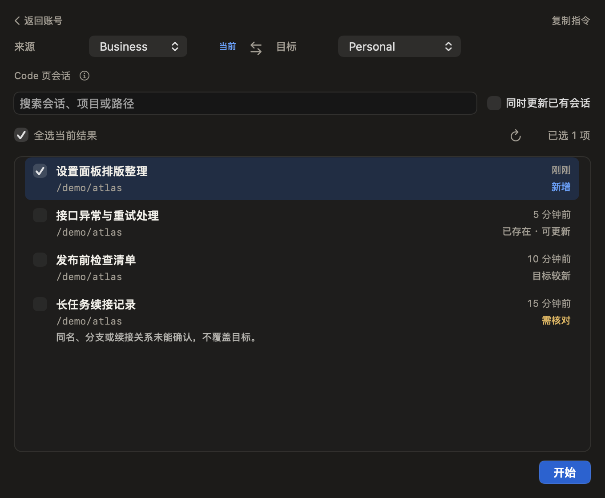
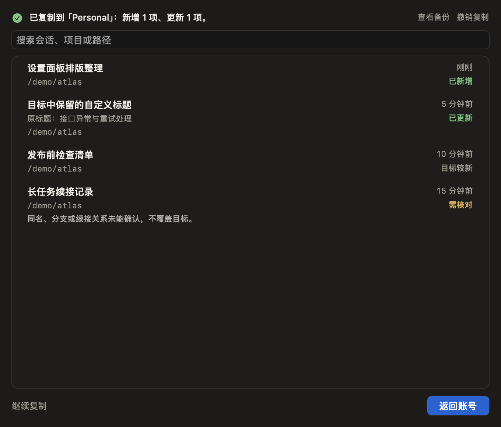
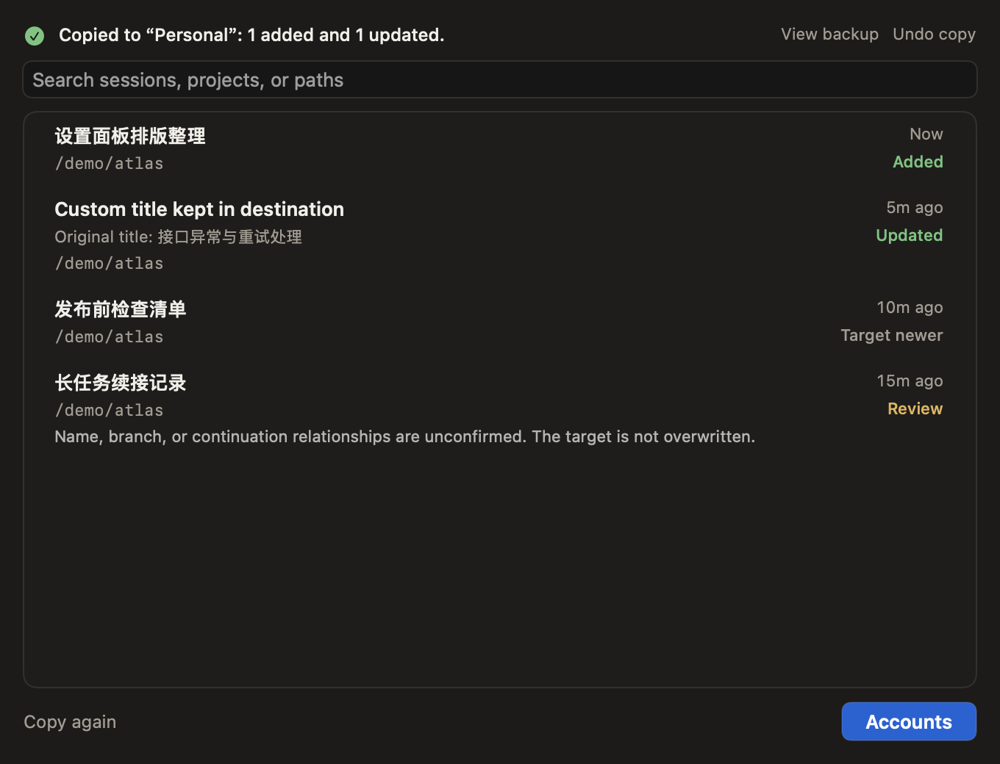
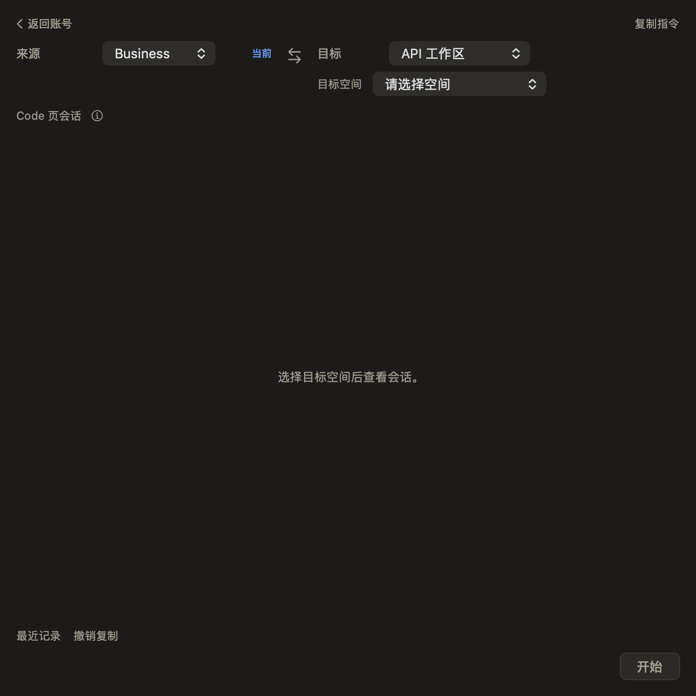

# 复制会话：一份列表，分阶段操作

2026-11-03。前端和文案由 Kimi CLI 实现，Codex 完成结果状态、隔离测试与视觉复核。作为 RC4 新构建 `20261103.4.1` 发布候选；旧 UI 的 `20261103.4.0` 产物保持停用，不复用其签名票据。

准备时选择来源与目标，一处统计实际选择；进行中保留同一列表并禁用写入入口；完成后在原列表内显示实际已新增/已更新。没有第二份结果清单或大结果卡。主动作从“开始”转为“返回账号”，继续复制为次级动作。

- 会话标题、路径和必要原因保留；项目简称不再与完整路径重复。索引/共享原文解释改为按需帮助。
- 未选择账号或多组织空间时，只显示精确选择提示，不把未检查当成0条会话，不显示两次空间标签。
- 默认选择可安全新增和同一 CLI 段的进度更新；底部直接显示新增/更新数量。手动取消后普通刷新不会重新选择，含更新时仍先确认具体条目并自动备份。
- 成功结果与本次来源、目标和操作绑定，冻结这次操作的来源快照；普通刷新不会把完成画面变回准备。新增实时会话在“继续复制”后重新读取，不混入旧结果。
- 搜索可以同时匹配原标题和目标实际保留的名称。只有真正写入的项目显示新增/更新，跳过和受限项不标成功。
- 返回同一窗口保留结果。冷启动历史记录没有来源绑定证据时，仅提供最近记录入口，不冒充当前任务成功。撤销、恢复与保留现状分别反馈。
- Core复制判断、续接限制、请求指纹和备份恢复策略不变；不承诺完整替代原同步脚本的续接覆盖。

## 2026-11-07 默认选择收敛

根据日常“旧会话继续对话”的主要场景，去掉额外的“更新已有会话”开关，不再要求用户先理解 CLI 段再操作。首次进入或更换来源/目标时，只默认选择后端判定安全的新增与更新；已同步、目标较新、身份或续接关系不明的项不参与默认选择。

“需核对”改为“暂不处理”，继续在该行显示具体原因。它表示没有充分证据安全更新目标，不是数据丢失，也不提供强制覆盖。主流程与备用复制指令使用同一份明确选择；含更新时确认与自动备份仍然保留。

250 项核心测试、419 项控制器检查及完整构建通过。覆盖新增与更新、取消后刷新、筛选、确认前零写入、返回与重进、备用指令、恢复。中英文原生离屏截图在等待虚构列表载入后复核；未访问真实会话，未进行真实账号或原生键盘/VoiceOver 验收。

## 验证

348项控制器/存储隔离检查通过；36张中英文原生离屏布局复核，覆盖520/580pt窗口、长标题、14条结果、异步处理中、重开、冷历史、改变目标、继续复制、撤销和恢复。复制后逐项核对目标标题和原文引用；源数据保持。原生鼠标、键盘、VoiceOver与真实Claude会话未作验收，不能用离屏结果代替。

## 准备

## 完成

## 英文最小窗口

## 多空间缺失选择

