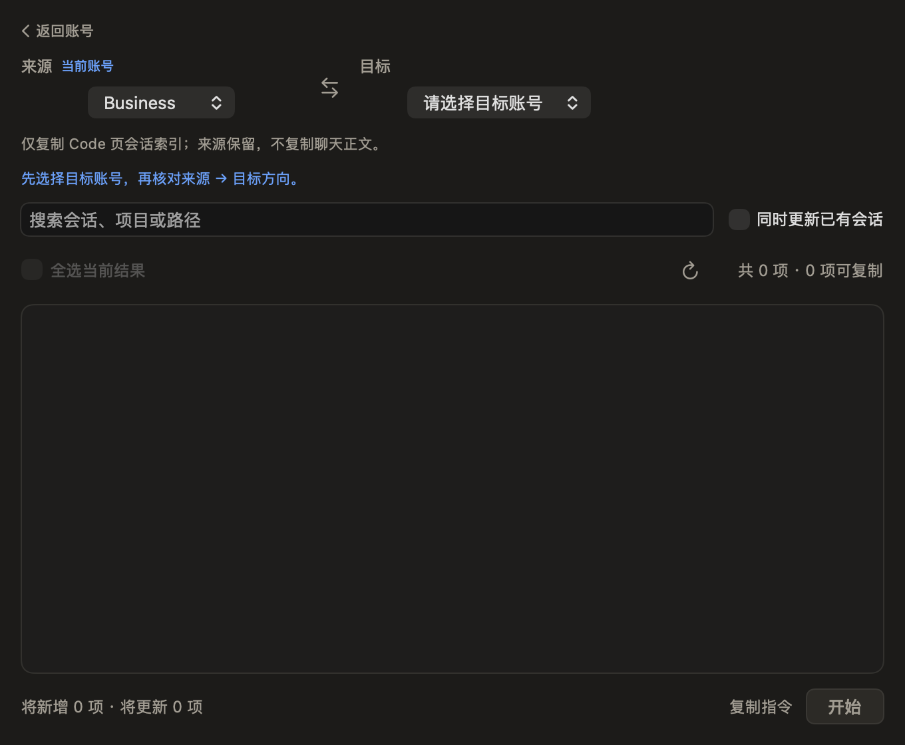
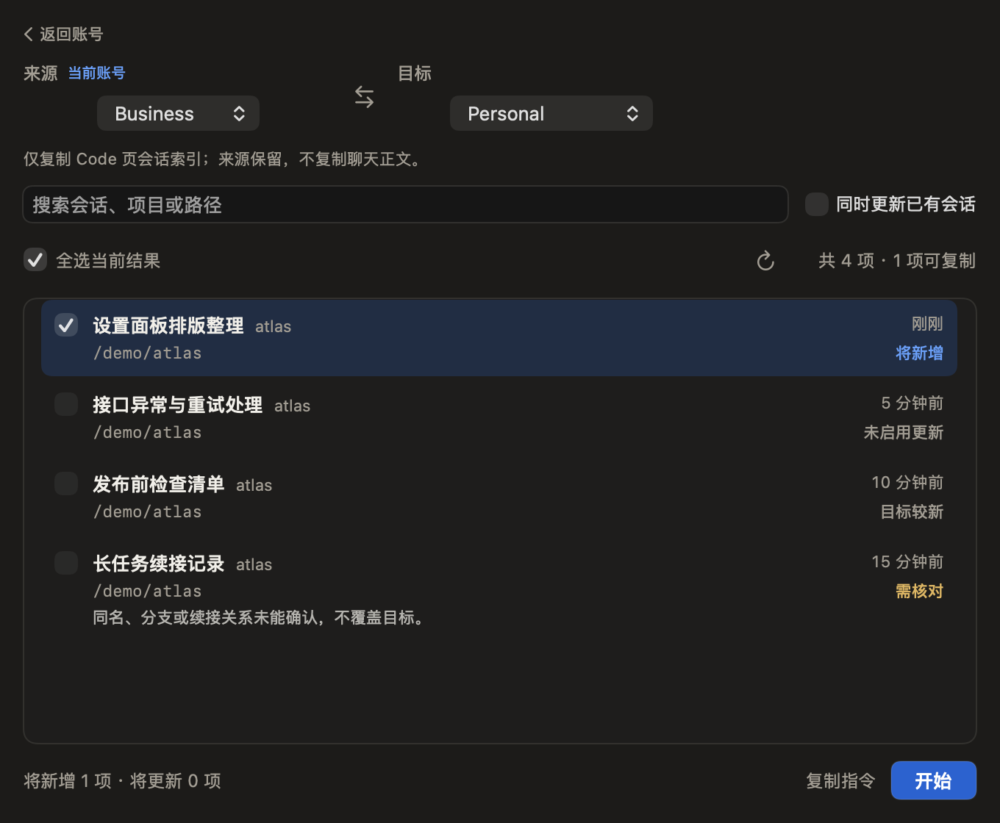
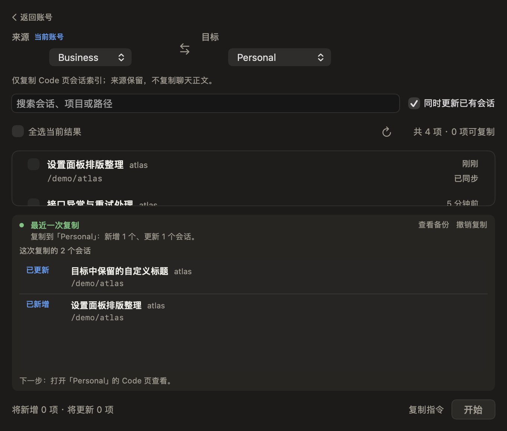

# 会话复制页：Codex 独立交互审查

2026-11-03。审查对象为 RC4 候选的复制页。按用户最新指示，发布和本机替换停在 UI_REVIEW_HOLD；未修改生产界面，本机仍为 RC3。签名聊天已停止后续动作。App 公证 Accepted 不代表这版交互已被认可，也不作为继续发布的理由。

## 结论

当前页面不适合直接发布。主要失误是把“保留具体会话信息”实现成“来源列表与结果列表同时常驻”。信息保留是必要的，重复布局则让会话本身失去主要位置。继续微调颜色、圆角、字号或列表最小高度不足以解决。

建议下一版围绕一份会话列表安排准备、进行中、完成三个阶段；同一会话对象在列表内更新状态，完整操作记录继续保存，不靠把信息全部折叠起来换取表面简洁。

## 用户目标

从当前账号将一批 Code 会话带到选定账号，知道会新增/更新哪些内容，操作后能辨认具体会话并返回账号页。既有的默认批量新增选择、一键复制指令、可撤销与不改真实登录/守卫等约束继续保留。

## 逐步证据

本轮重新生成并逐张检查截图，使用实际 SwiftUI 视图、控制器和临时虚构索引；未访问真实会话。首次未加载的空白测试截图没有作为证据。这里是视觉/状态流程审查，不是生产环境鼠标键盘端到端验收。

### 1. 未选目标：引导存在，但空态混乱

健康程度：需要改进。目标选择器有占位提示，这是正确的；但尚未比较目标时已经显示“共0项、0项可复制”，下面还有空白列表、不可用的全选和“将新增0、将更新0”。用户容易误以为当前账号没有会话。

改进方向：让“选择目标”成为这个阶段唯一缺失动作；列表区提供一句明确空态，暂不显示尚无意义的数量和操作预告。不要用错误的0替代“尚未检查”。

### 2. 待复制：路径可用，但信息层级和文案偏重

健康程度：功能路径可用，视觉负担过高。方向和当前账号能辨认，全选与更新的实际范围也已改正；问题在于说明、全选、共多少/可复制多少、每行将新增/可更新未选、底部新增/更新，重复表达了选择和动作。

单条会话还同时展示标题、项目简称、完整路径、活动时间、状态及可能的长原因。项目简称本来就是路径末段，默认一起出现价值有限；长路径和技术原因会抬高行高，拖慢扫读。选择器标签与控件可见左缘也不一致，横向留白没有帮助主要内容。

改进方向：标题为主，第二行保留足以识别项目的位置；完整路径和详细原因可按需查看，重要的不可复制原因仍要短句可见。一处选中/新增/更新统计即可。复选框已经表示未选，不必每行再写“未选”。保留默认批量选择习惯，不照搬其他产品默认全不选。

### 3. 复制完成：最严重的结构问题

健康程度：不应按现状发布。

- 来源列表与结果清单同时存在，形成两个滚动区域和两套上下文。同一会话的标题、项目和路径被重复展示。
- 默认约580pt高度中，主要来源列表只剩约70–80pt，结果卡约占230pt；源列表只露一条多一点，结果区仍有空白。此为本次截图近似观察，不是通用设计标准。
- 顶部仍是准备复制的编辑器，底部仍是“将新增0、将更新0”和禁用“开始”，中间却已经宣布完成。用户无法通过主动作自然结束任务。
- “最近一次复制”“复制到目标后的统计”“这次复制的总数”“逐项结果”“下一步说明”连续堆叠，其中多处在重复成功事实。
- 已完成后的主要动作应该是结束当前任务或返回账号页；查看备份、撤销可保持次级可达。普通复制与高级命令也不应像两个同级执行入口。

改进方向：复用一份列表呈现结果，保留所有会话和必要状态；完成信息收敛为一条目标与结果摘要，底部转为“返回账号”或“完成”。未复制项留在原列表说明原因，不再另起大块完整清单。目标保留了自改标题时，要保留可辨认的对应关系。

## 优先级

| 优先级 | 问题 | 下一版的判断标准 |
| --- | --- | --- |
| P1 | 两份列表挤占同一任务 | 具体会话仍可识别和查找，默认只有一个主要滚动区 |
| P1 | 完成与准备状态混排 | 完成后不再出现下一次操作的0预告和死的开始按钮，有明确结束动作 |
| P1 | 页面重点偏离会话 | 正常窗口里能连续扫读多条会话，不能把主要列表压成一行 |
| P2 | 同一信息反复解释 | 方向、选择统计、成功结果各在最有用的位置说一次 |
| P2 | 领域/实现术语与冗余元数据 | Code页范围清楚；索引、原文共享等技术细节有按需解释，长路径不支配页面 |
| P2 | 空态把未检查写成0 | 能区分尚未选目标、真正无会话、没有搜索结果、未能读取 |
| P2 | 普通路径与高级路径权重 | 常规操作只有一个主要行动，一键复制指令保持低频可达且不新增预览步骤 |

## 文案取舍示例（评审建议，尚未写入产品）

- 用标题或简短范围标签说清“Code会话”，无需每次常驻解释一整句存储实现。
- 选择前可用“选择目标账号后查看会话”，不同时展示三处0数量。
- 行尾可用“新增”“更新”“已同步”“保留目标”；未选由复选框表达，必要的异常另用短句说明。
- 执行前只保留一处真实选择摘要；完成后只保留一处“已复制到某账号：新增N、更新M”。
- 主动作按阶段表达：准备时开始，进行中显示进度，完成后返回账号；不自动切换账号或结束Claude。
- 不把未确认续接藏起来或标成成功；简化展示不等于放宽复制规则。

## 参照与本产品取舍

- [Apple：Principles of great design](https://developer.apple.com/videos/play/wwdc2026/250/) 强调简洁、清晰层级和避免冗余，也提醒把功能全藏起来不等于简单。借鉴点是梳理任务与必要信息，而不是继续堆折叠层。
- [Apple：Make a big impact with small writing changes](https://developer.apple.com/videos/play/wwdc2025/404/) 讨论去填充词、去重复和一致用词。借鉴点是删掉整块重复表达，而非只替换几个形容词。
- [Apple：Buttons](https://developer.apple.com/design/human-interface-guidelines/buttons) 要求动作目的清楚，并突出用户当前最可能选择的操作。完成后保留禁用开始不符合本任务的主要下一步。
- [Linear：Select issues](https://linear.app/docs/select-issues) 将选择和批量动作围绕同一列表组织。这里借鉴选择范围与动作上下文；用户已确定的默认批量选择习惯不机械套用Linear默认全不选。
- [Raycast：List](https://developers.raycast.com/api-reference/user-interface/list) 区分标题、辅助元数据和详细内容，并建议详细区打开时不要重复列出相同附件信息。借鉴点是明确主次，避免把每一层数据都常驻展示。

以上建议是依据这些模式、当前截图和用户目标作出的设计判断，不声称某个标杆产品规定了本页必须采用同样的布局。

## 可访问性与证据边界

当前标题、状态和复选框能够提供基本辨识，原有多选混合态也值得保留。还需验证键盘阅读顺序、焦点恢复、主按钮自定义样式的焦点提示、结果更新后的屏幕阅读器通知，以及实际窗口滚动体验。不能由截图推出已全面符合可访问性要求，也不将手机触控尺寸规范机械套到Mac控件。

本轮没有修改产品UI、继续安装或发布；没有操作真实账号、会话、代理或守卫。下一步应先形成单列表、分阶段的结构稿，再由Kimi实现并用同样场景对照复核。
