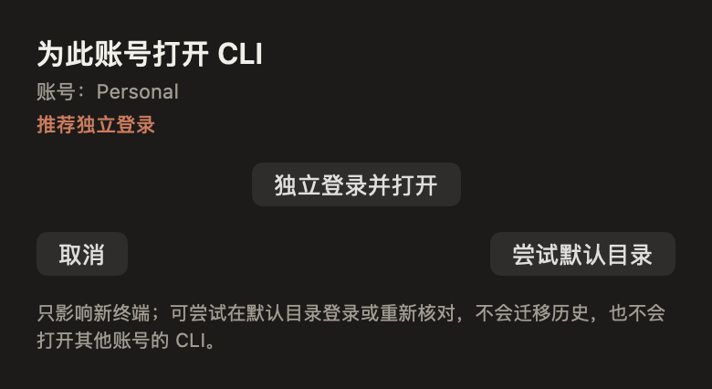
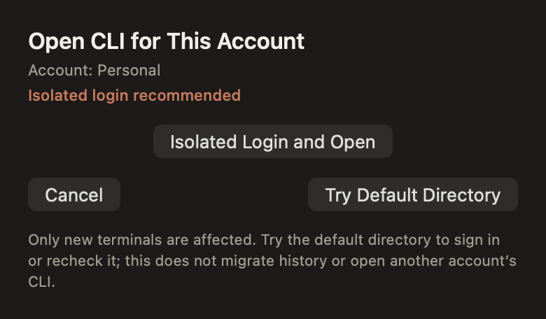
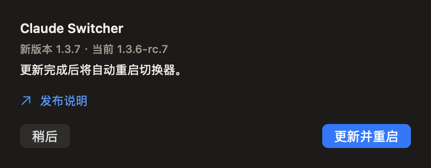

# RC7 本地验收

候选版本：`1.3.6-rc.7`，分发构建 `20261105.7.2`。本页区分代码测试、界面渲染与签名更新安装。

2026-11-05 结果：248 项核心测试、354 项控制器检查、15 项打包流程测试通过；22 张中英文离屏渲染已复核。后续使用签名、公证夹具完成实际更新与回退，结果见 [签名验收](../../signing/RC7.md)。首次关联面板曾出现空账号和按钮失效，Kimi 改为固定身份的面板数据后复测通过；同名档案的真实身份变化也会关闭旧选择。

## 已验证的行为

| 范围 | 证据 | 结果 |
| --- | --- | --- |
| CLI 关联 | 默认账号和组织匹配则沿用；不匹配不覆盖；独立目录待登录和核对成功分开；返回原账号复用原目录 | 假数据通过 |
| 历史保留 | 关联记录只存身份和路径；历史哨兵文件保持原样；启动命令不带强制 `/login` 或 `/logout` | 临时目录通过 |
| 状态准确性 | 账号变化后的旧响应不写入新关联；超时、权限和身份不完整不会变成已登录或已退出 | 假数据通过 |
| 保护 | 等待新鲜、同配置回报；超时可以直接重试；网络不通过仍是在线守卫，但不是放行 | 假守卫通过 |
| 更新事务 | 正常退出后交换整个 App；启动失败或无确认回退；拒绝退出不强杀；中断后的版本对不重复交换 | 临时 App 和独立假进程通过 |
| 更新输入 | 旧构建、错误身份、受损下载、不属于本次请求的暂存路径、符号链接拒绝安装 | 夹具通过 |
| 打包 | 版本、更新协议和四个可执行文件完整；签名脚本的输入和发布清单处理 | 未签名构建与脚本夹具通过 |
| 界面 | 正常、等待、失败、首次选择和更新进度的中英文布局；同名档案换身份后旧面板关闭 | 离屏渲染通过 |

测试入口：

```sh
swift test
bash scripts/test-controller.sh
python3 scripts/test-developer-id-release.py
bash scripts/render-unified-controls.sh
bash build.sh stage-unsigned
```

渲染脚本依赖控制器测试生成的模块，输出到 `_qa/rc7/visual/images/`。它只创建不可见的虚构窗口；没有运行产品入口或读取真实账号。测试中的签名失败是注入结果，不能表述为已经完成真实 Developer ID 信任链验证。

界面和产品文案由本机 Kimi CLI 实现，Codex 负责后端、假数据测试和整合复核。离屏面板的系统按钮可能呈现非活动窗口配色，不能据此判断真实窗口焦点或点击效果。







## 后续边界

- 签名与公证夹具的完整更新、重启确认和回退已另行实测。真实账号不是测试夹具。
- Gatekeeper 和完整安装包已验证；真实钥匙串授权继承未做测试。不得从相同 Bundle ID 推断钥匙串不再询问。
- 原生鼠标、键盘与 VoiceOver。离屏渲染用于发现布局和状态传递问题，不算人工交互验收。

开发和夹具验收没有切换真实账号、迁移会话、恢复失效备份或测试真实网络故障。后续本机 Preview 更新单独执行并记录，不停止或重新注册守卫。

## 首次升级说明

RC6 不含更新助手，因此第一次进入支持自动安装的版本仍需完整安装一次。RC7 以后的一键更新要求目标包包含协议版本 1 和签名的 `ClaudeUpdater`；条件不满足时保留原版并给出明确提示。
