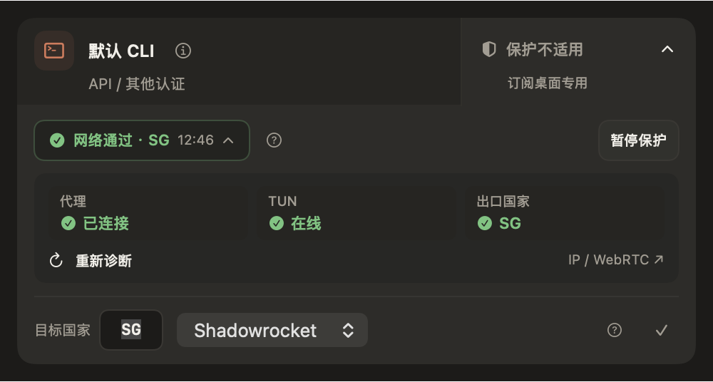

# 1.3.6 RC12 · 预览版

本版在 RC11 的账号、终端和会话流程基础上，进一步收敛保护设置，并明确网络诊断不会取消保护。

- 未检查时显示「网络诊断」，检查后就地显示通过结果或具体失败原因；点击同一位置展开代理、TUN 和出口详情。
- 详情内提供「重新诊断」，第三方 IP / WebRTC 体检作为辅助入口放在详情中，不影响保护门禁。
- 删除无信息量的「保护设置」标题，诊断与暂停同行，减少空白；草稿未保存时仍保留明确的「保存更改」。
- 增加回归：保护中执行网络诊断，保护开关、桌面绑定、守卫判断和回执时间均保持不变。
- 保留 RC11 的桌面账号独立额度查询、CLI 复用与旧备份恢复、会话导入及底部直接刷新。

支持 Apple Silicon、macOS 13+。本版为公开预览，1.3.5 保持正式 latest；升级不会替你切号、恢复凭据或迁移真实会话。

完整验证、签名、公证、分发和本机安装结果见 [RC12 交付记录](1.3.6-rc.12-delivery.md)。

