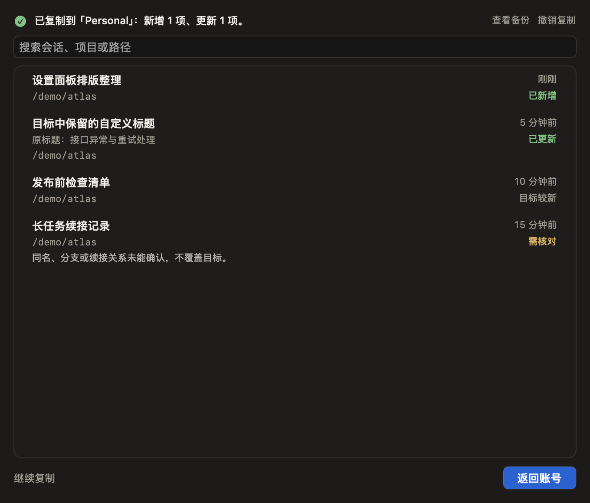

# Claude Switcher 1.3.6 RC4

会话复制，一份列表就看清。

**[下载 macOS DMG](https://github.com/liuquanqing/claude-switcher/releases/download/v1.3.6-rc.4/ClaudeSwitcher-1.3.6-rc.4-arm64-developer-id-preview.dmg)** · [SHA256 校验](https://github.com/liuquanqing/claude-switcher/releases/download/v1.3.6-rc.4/SHA256SUMS)

Apple Silicon · macOS 13+ · 预览版

## 本次更新

- **方向明确**：从当前账号出发，目标明确选择；可交换来源与目标。账号或组织空间未选时只显示对应提示，不误报没有会话。
- **一份列表看全程**：准备、处理中和完成共用同一份会话列表。复制完成后，直接标出实际已新增、已更新和未处理项。
- **明细一直可查**：保留具体标题和路径，目标的自改标题也保留；可以按原名或目标名搜索。同一操作返回重开仍保留结果，历史记录不冒充当前任务成功。
- **操作有收尾**：完成后主按钮是“返回账号”，继续复制为次级动作；备份、撤销和恢复保持可达。复制指令仍一键复制，不新增预览步骤。
- **文案与空间收紧**：去掉双列表、大结果卡和重复统计，零值不再堆叠，完整路径与技术说明可按需查看。

## 验证与范围

228项核心测试、348项隔离检查通过，36个中英文原生离屏布局完成验证。覆盖最小窗口、长标题、大批量、异步处理中、返回重开、冷历史、改变目标、继续复制、撤销与恢复。未以真实账号或会话作测试；原生键鼠和VoiceOver不以离屏结果替代验收。

仍只复制 Code 页的会话索引，不搬走原文，不删除来源会话。无法确认的续接仍显示需核对；本版不扩大索引覆盖规则，不全局接管 CLI，不新增网络层即时断流。

版本 `1.3.6-rc.4`，最终构建 `20261103.4.1`。旧 UI 构建 `20261103.4.0` 未发布、不可安装；应用与DMG已完成Developer ID签名、公证Accepted、加票与Gatekeeper检查；父侧独立核验最终ZIP票据及DMG只读挂载、身份、架构和哈希。[精确运行源码CI](https://github.com/liuquanqing/claude-switcher/actions/runs/41596835950)通过；签名构建源码 `e28a4fdb180c676cb4523efa6789adb166747a0f` 的 App/Sources 与已检查的 `d33dda383c677ff58c8fc641a2dd26795f40568e` 逐文件一致。保留1.3.5正式版与全部历史附件。

已有守卫的机器须保留其注册组件路径，不要为清理旧GUI直接删除；本机更新只替换Preview界面，保持守卫、账号与真实会话不变。

感谢 [l2succes/claude-switcher](https://github.com/l2succes/claude-switcher) 原作者与相关开源项目，保留 MIT 许可证和原有署名。

## English

Session copying now uses one list for selection, progress and results. Copied and updated sessions stay visible with their actual destination titles. The primary action returns to Accounts after completion; backup, undo and recovery remain accessible. Missing account or organization selection is explained without false zero counts, and command copying remains a one-click fallback.

228 core tests, 348 isolated checks and 36 fictional native layouts were verified. Real login/session use, native keyboard/mouse and VoiceOver acceptance were not substituted by fictional tests. The app and DMG are Developer ID signed, notarized and stapled. This is a prerelease; source sessions and existing guard paths must be preserved. Unverified continuations remain blocked.
