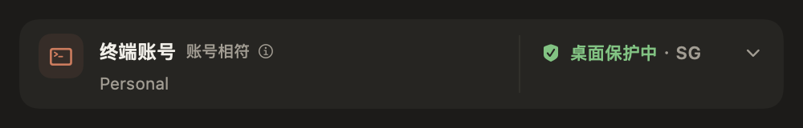

# RC8 交付验证

版本 `1.3.6-rc.8`，构建 `20261105.8.1`。此记录在验证完成后更新，不把编译、签名、安装和真实账号验证混为一项。

## 本地功能验证

- 250 项核心假数据测试通过。
- 366 项控制器检查通过，新增 A→B→A 的终端对应、未知默认状态的独立准备、专用目录额度归属、原采样时间及历史保留测试。
- Kimi 完成界面与文案并查看虚构截图后收尾；Codex 完成整合编译和中英文截图复核。
- 覆盖订阅、Magpie、CC Switch、未知来源和展开设置。为截图设置的初始展开状态及来源输入只存在于 `_qa` 下生成的测试副本，产品构建不包含这些测试入口。
- 图标使用现有资源。键鼠和 VoiceOver 的真实操作未作为本轮通过项。

## 分发验证

最终 build `20261105.8.1` 已完成 Developer ID 签名、App 与 DMG 的 Apple 公证、加票及 Gatekeeper 验证。精确分发 ZIP 解包、只读 DMG 和四组件字节一致性核验通过。此前 RC7 与内部 build 8.0 的产物保留，没有复用旧票据或改写旧标签。

用最终分发包里的更新助手完成五个虚构案例：正常升级 `complete`，无启动确认时 `rolledBack`，旧版拒绝退出时保留旧版，新版拒绝回退退出时保留两份，坏签名拒绝安装。回退断言会等待旧版的真实启动记录，不把异步启动回调误当作界面已经就绪。

运行代码来自 `fd0ffe58980945e328cefcaf0c1a292b5e493322`，[主分支 CI 全部通过](https://github.com/liuquanqing/claude-switcher/actions/runs/42025007604)。后续验收工具和文档提交不改变 App、Core 或构建元数据。

本机 Preview 已使用签名助手正常升级至 build 8.1 并完成启动确认。原版应用散列、守卫配置与注册保持不变，没有停用或重新注册守卫，也没有执行账号切换、凭据还原或真实会话迁移。真实钥匙串 ACL 继承仍为未测项。

## 运行边界

不以真实登录、会话或代理故障为夹具，不恢复或刷新失效备份。只读观察不会改变凭据或启动官方 CLI。用户主动打开终端时，仍由官方程序处理登录及其有效性。
