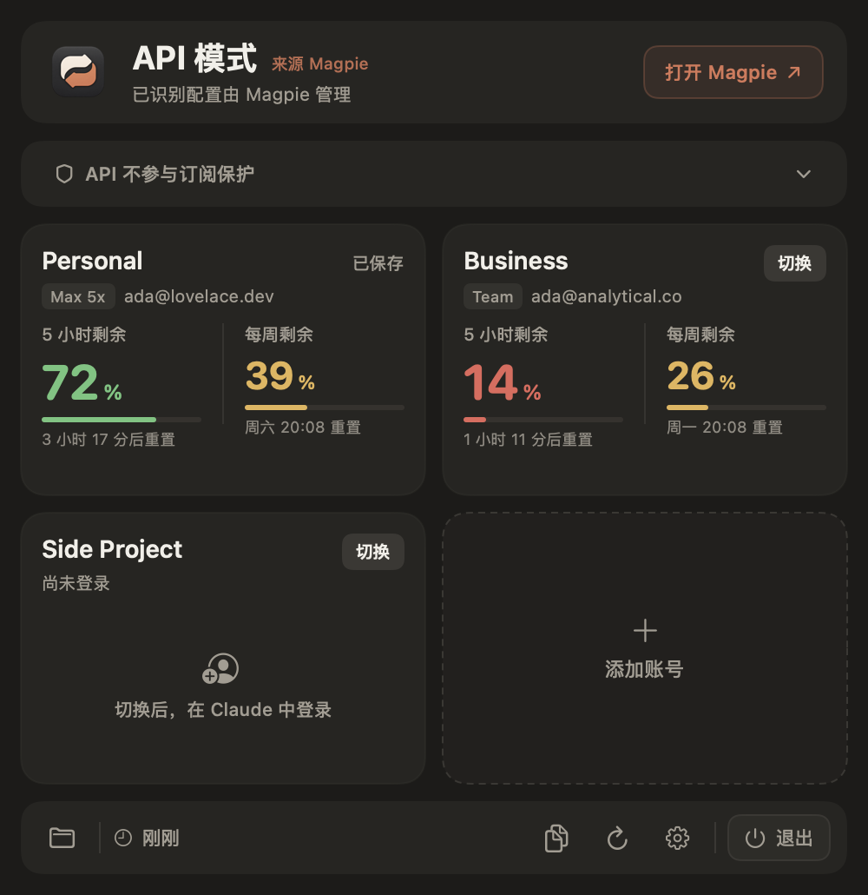
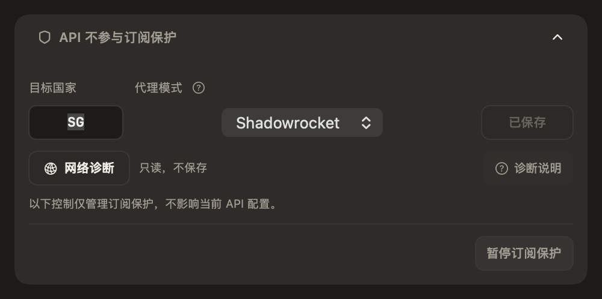

# RC8 交付验证

版本 `1.3.6-rc.8`，构建 `20261105.8.0`。此记录在验证完成后更新，不把编译、签名、安装和真实账号验证混为一项。

## 本地功能验证

- 250 项核心假数据测试通过。
- 366 项控制器检查通过，新增 A→B→A 的终端对应、未知默认状态的独立准备、专用目录额度归属、原采样时间及历史保留测试。
- Kimi 完成界面与文案并查看虚构截图后收尾；Codex 完成整合编译和中英文截图复核。
- 覆盖订阅、Magpie、CC Switch、未知来源和展开设置。为截图设置的初始展开状态及来源输入只存在于 `_qa` 下生成的测试副本，产品构建不包含这些测试入口。
- 图标使用现有资源。键鼠和 VoiceOver 的真实操作未作为本轮通过项。

## 分发验证

等待本次完整 App、DMG 的签名、公证及精确产物核验；此前 RC7 的票据与标签不复用、不改写。

## 运行边界

不以真实登录、会话或代理故障为夹具，不恢复或刷新失效备份。只读观察不会改变凭据或启动官方 CLI。用户主动打开终端时，仍由官方程序处理登录及其有效性。
