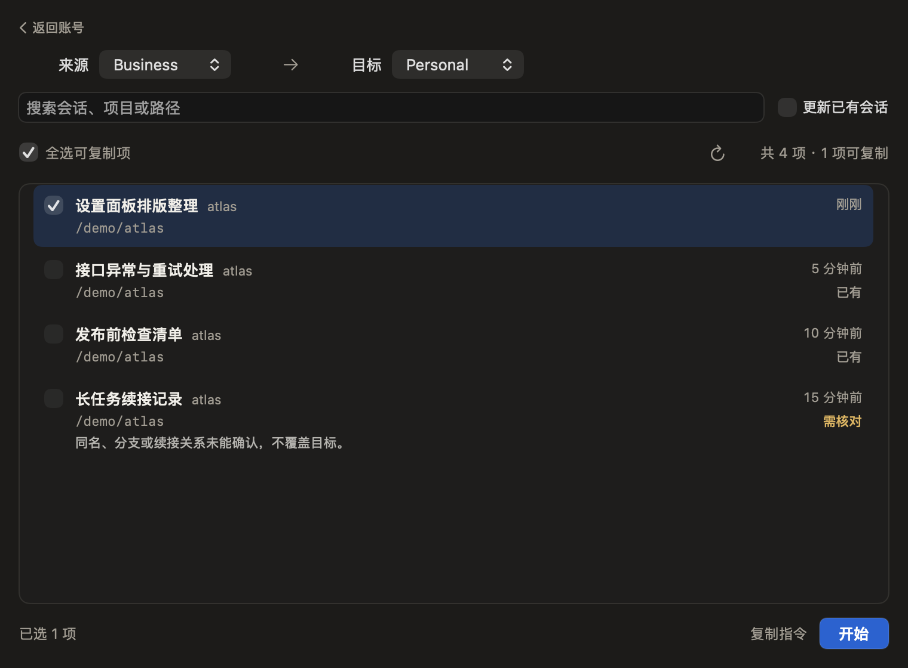
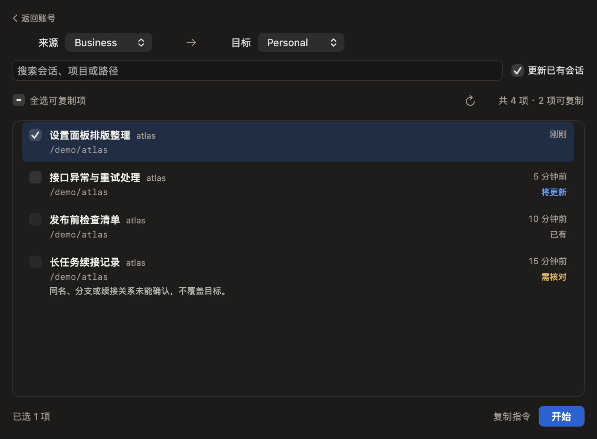
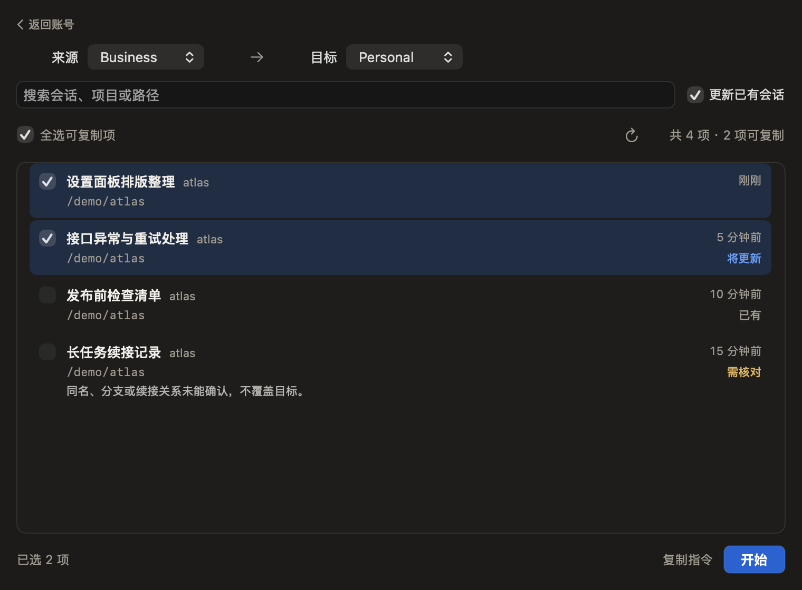

# 会话复制与现有同步脚本对照

2026-11-03。范围为已发布 RC3 的会话复制实现与用户指定的 `sync-desktop-sessions.py`。只读脚本源码；执行对照全部使用新建的临时 HOME、虚构索引与原文。未执行用户原始 `--apply` 命令，未读取真实账号目录或会话原文，也未改变安装应用、登录、网络或守卫。

## 结论

核心用途相近：把 Claude Desktop **Code 页**的本地会话索引带到另一账号或工作区；共享原文仍在 `.claude/projects`，不会因为复制索引再搬一份。当前应用不是该脚本的完全等价替代。方向、默认更新策略、续接处理与备用命令都存在实质差异。

用户命令的意图可抽象为：当前 `Claude/claude-code-sessions` → 已保存 `Claude-Profiles/Work/claude-code-sessions`，来源账号前缀 → 目标账号前缀，复制完成后再切换。本文使用虚构的 Work、1111、2222 表示目标档案及账号标识，不记录用户真实映射。前缀是脚本匹配的账号目录标识，不是会话ID。脚本对未指定的组织选择会话条目最多的一项；应用多空间时要求明确选择。本文没有验证用户真实目录和前缀是否存在。

## 功能对照

| 项目 | 用户脚本 | RC3 应用 |
| --- | --- | --- |
| 路径范围 | 显式源/目标 sessions 基目录，可跨保存档案或 API 目录 | 已保存档案及 Claude-3p 工作区，当前账号绑定 liveDir，其他账号绑定其保存目录 |
| 默认方向 | 由命令显式指定，用户本例为当前 → design | 新控制器默认目标为当前账号，来源为另一个非 API 档案；可能与用户意图相反 |
| 缺少的索引 | 自动新增 | 默认预选可新增项并新增，不搬共享原文 |
| 已有同一会话 | 来源轮数更多即可整体覆盖索引 | 默认跳过；开启更新并选中后，核对同一 logical/CLI/cwd 和进度，再仅更新轮数与活动时间，保留目标自改标题等字段 |
| 新旧 CLI 段续接 | 目标 CLI 在来源 priorCliSessionIds 中也会覆盖 | 目前不能据此确认接续点，阻止覆盖；这项用途尚未等价实现 |
| 目标时间更晚但轮数较少 | 仍可能因来源轮数更多而覆盖 | 保留目标，不把无法比较的进度当作落后 |
| 归档、删除和缺失原文 | 跳过相应条目，当前 CLI 原文只要求存在 | 还要求引用与历史分段原文可读且唯一，不把未知目标视为不存在 |
| 备份与恢复 | 覆盖项备份并生成回执 | 变更日志、备份核对、撤销与中断恢复，遇到外部修改保留新数据 |
| 运行中桌面 | 脚本不检查，提示重启读取列表 | 图形入口写入当前 live/API 目标时要求退出桌面；保存的非活动目标不因当前桌面运行而自动阻止。备用命令还要求桌面和切换器写入入口退出 |
| 备用指令 | 直接给路径与前缀 | 绑定已导出请求与预检指纹，不能把任意 --from/--to 命令当作同一协议；切换后目录变更可能使旧请求失效 |

## 七组虚构数据实测

在两个独立临时目录放入同样的七组索引：缺少项、同段可更新、续接段、目标时间较新、目标轮数较多、已同步、历史原文缺失。脚本实际执行只指向假 HOME 与假目录；应用调用当前真实迁移引擎，也只指向假目录。

- 脚本：新增 2、覆盖 3。
- 应用默认：只有 1 项可新增；同段更新尚未开启，其余分别跳过或阻止。
- 应用开启更新并选择全部可执行项：新增 1、更新 1。
- 应用保留了目标自改标题，脚本覆盖该标题；两者的来源索引与共享原文均未改动。

这些数字只用于说明规则差异，不代表用户当前真实会话的预览结果。

## 界面试走

以下截图来自当前产品视图、真实控制器和临时虚构数据，使用不可见 NSWindow 完成原生离屏布局。它们不是生产数据，也不是鼠标/键盘端到端验收。第一次未完成 List 布局的截图已拒绝，不作为产品缺陷证据。

1. **首次进入：方向不符合切换前带走。** 假当前账号为 Personal，实际默认来源 Business → 目标 Personal；默认勾选 1 条新增会话。

   

2. **勾选更新：预告不准确。** 同段更新行变成可选，但仍未勾选；右侧却显示“将更新”，底部仍“已选 1 项”。这会使用户误认为更新已纳入本次操作。

   

3. **全选当前可执行项：选择规则工作正常，但结果缺少分解。** 2 条可执行项被选中，已有与无法确认的条目不被选中。底部没有说明这 2 条实际为新增 1、更新 1。

   

## 当前版本怎样对应用户命令

1. 来源选择当前账号；目标选择 `Work`。若有多个空间，分别选择与 `1111`、`2222` 对应的账号/组织范围。
2. 需要已有进度更新时，显式开启“更新已有会话”，再点“全选可复制项”（或分别勾选所需行）。只开启开关并不代表已经选择更新行。
3. 点“开始”，有更新时核对确认清单；成功后返回账号页，再切换到 `Work`。被标为“需核对”的续接记录不能靠全选越过限制，因此无法保证与原脚本带过去的内容相同。

本文只描述操作对应关系，没有执行用户的真实复制。

## 优先改善

- 让切换前的默认方向从当前账号出发，目标明确选择，保留交换方向能力；不增加“带入/带出”两套模式。
- 顶部和结果摘要说清范围；默认批量选择要尊重用户已有的全选习惯，不能误认成只复制一条当前聊天。
- 显式开启已有更新后，让选择与预告一致；未选的行应写“可更新”，不能写“将更新”。
- 底部展示新增/更新数量，区分已同步、目标较新与尚未开启更新，而不是统一“已有”。
- “复制指令”保留一键写入剪贴板和成功提示，不重新增加用户已否定的预览弹层。备用入口不替代主流程。
- 续接与未知格式属于后端能力缺口，需要单独设计可核验的规则；不得通过 UI 优化直接解除覆盖限制。

前端方案另由 Kimi 复核，Codex 负责功能对照、证据校验与最终取舍。本次不改生产代码或已安装应用。续接覆盖尚未等价实现，属于需要单独验证和设计的能力缺口，不能只优化 UI 就宣称已完全替代原脚本。
