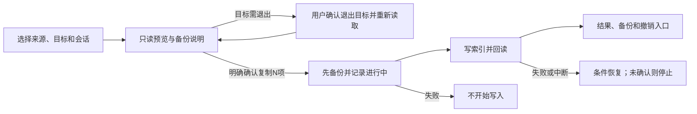

# 会话复制与增量迁移方案

## 2026-10-28 实施更新

用户已授权隔离实现、测试后启用与同步 GitLab，并由 Kimi 完成精简稿及原生接线。当前 local.6 已构建并开放已适配的迁移入口：154 项既有核心测试、75 项隔离控制器检查，以及复制、恢复、返回和备份缺失等原生假数据流程通过。现用原版保留；独立候选已更新 local.6 但未启动，真实会话未读写。详细事实与边界见[实现进度](会话迁移实现进度.md)。本文件继续作为设计草案保留，不冒充正式交付 profile 的确认。

交互以[Kimi 最新说明](会话迁移交互设计.md)为准：默认新增直接复制，只有包含更新时确认；不再要求所有操作经过大预览页或独立结果页。目标仍运行时只要求用户自行退出并重新检查；网页返回、关闭备份和取消确认均不触发写入。本版 22 组浏览器检查与 10 月 27 日旧稿 29 项记录分开保存。

以下是 10 月 27 日方案起草时的事实快照，不能当作当前实现状态。

## 起草时判断

保留原版的“来源 → 目标 → 勾选会话 → 复制”窗口。增加跨 API 空间、可选择的增量更新和执行前预览；备份自动完成。普通复制不清空目标列表，不变成一套聊天备份系统。

本轮范围是方案与虚构数据交互稿。方案、合成夹具和Kimi可点击稿现已完成；首轮问题修正后29项浏览器交互/响应式检查通过。**没有实现下述新迁移引擎，没有启用复制入口，本轮工具没有读取或修改真实会话。**

| 层次 | 当前事实 |
|---|---|
| 最近本地交付 | `ef47667` / `v1.3.0-local.5`；99 项 XCTest 与 33 项隔离控制器检查通过，其中10项是仍禁用的基础索引复制原型测试 |
| 正在运行 | 只读检查确认旧版保镖仍加载；两份旧切换器进程保留。未确认其真实账号，不读取会话来验收 |
| 安装候选 | 已另装 `/Applications/Claude Switcher 候选版.app`，独立 bundle ID；未自动启动、未注册新守卫。旧服务交接单独处理 |
| 当前复制原型 | `ThreadRepository` 已有枚举、目标组织和只新增复制；`sessionMigrationEnabled` 固定为 false；没有本方案的增量、跨模式计划/备份执行流程 |
| 本次规划候选 | 本方案、Kimi单文件交互稿与说明；29项浏览器仿真检查通过。新引擎仍未实现，原型只操作虚构数据 |

用户最新约束：守卫与急停以隔离仿真为验收依据，不安排真实账号断网、切节点或强停故障测试。此前“真实急停待安排”的历史描述由此取代；不能因此把 OS 实际急停写成已实测。

本仓库没有明确登记的交付 profile。依照交付规划契约，只保留 draft；正式 profile doctor/lint 为 `NOT_RUN_PROFILE_MISSING`，不伪造项目权限配置来取得通过。用户要求的设计草案和原型仍照常交付。

## 价值

- 普通用户仍只需要选会话，不理解账号目录、JSONL 或 API provider 配置。
- 同一会话已经共享原文时，避免重复复制“整段历史”；确需更新的列表进度与续接引用有明确预览。
- 用显式来源、目标和组织代替脚本里的固定路径、短前缀或“选条目最多的组织”。
- 将会覆盖哪些索引、备份什么、失败恢复到哪一步展示清楚。

## 目标

首期仅支持**同一台 Mac、同一用户下已初始化的桌面 Code 会话空间**：

1. 订阅档案之间，以及订阅档案和 `Claude-3p` API 空间之间复制索引。
2. 缺失索引新增；用户显式开启后，更新可证明为同一会话的进度或续接引用。
3. 搜索、按项目筛选与选择；预览新增/更新/跳过/需处理的原因。
4. 所有实际变更前自动备份；结果有本次收据、备份查看和受条件限制的撤销。
5. 保留源索引、共享原文、目标较新进展和用户自行改过的数据。

## 非目标

- 不迁移 Claude 云端普通聊天、Cowork/VM、工作区文件、远端连接或完整运行环境。
- 不复制、改写或合并 `~/.claude/projects` 中的 JSONL 原文；不是跨机器备份/恢复。
- 不修改 OAuth、钥匙串、`.claude.json`、API 密钥、模型、provider 或 deploymentMode。
- 不包装原来的 reset 脚本；不清空目标列表，不自动移走未选会话。
- 不自动切号、切 API 模式、停止 CLI 长任务或后台持续同步。
- 首期不导入归档/删除会话，不恢复被目标归档或删除的条目。扩展归档行为需单独核对其格式与界面语义。

## 交互方案

正常目标已关闭时只有选择、预览两步。运行目标需要退出后的再次确认，不能为减少点击而省掉对回写内容的复核。

### 一、选择会话：沿用原窗口

顶部仍为来源与目标。下拉列表显示 `Personal · 订阅档案`、`Business · 订阅档案`、`API 工作区 · 配置匹配 Magpie`。名称来自本地档案及模式配置，不证明当前登录、云端组织权限或实际代理进程；复制本机索引也不以在线登录核验为前提。

- 来源、目标各自只有一个已确认的本地账号/组织 namespace 时自动选中并显示名字；任一端有多个时，该端的账号/组织选择必填，不按条目数、目录顺序猜测。预览绑定完整namespace，UI显示空间名称与短标识；已有条目数只供参考，不能作为自动选择依据。
- API 目录中的 namespace 只能说明本地空间，不能当成已认证的云端账号/组织。读取 API 密钥与网关地址不是此步骤的依赖。
- 目标未初始化时，提示先在原工具打开目标模式的 Code 页；不能替用户登录、切模式或随意创建账号目录。
- 来源与目标实际解析为同一空间时禁用复制。来源/目标变化后清空旧选择与预览。
- 搜索不清除隐藏的选择；“全选当前结果”只选择当前筛选中可处理的项。
- **“更新已有会话”默认关闭**，保留原版只新增的语义。开启后解锁可更新项；关闭时取消已选择的更新项并告知数量。
- 不可复制的行禁选，原因可查看：目标更近、无法确认同链、原文缺失、目标索引不可读等。

底部主按钮为“预览复制 N 项”，不是直接写入。常态只留短说明，技术路径与规则放“了解复制”或行详情。

### 二、预览：不是另一套大型向导

在原窗口内展示待执行清单。用户能看到：

- 来源、目标与组织/空间，不使用会随目录轮换而改变的路径作为唯一身份。
- 将新增多少、更新多少、跳过多少；具体项与理由。
- 更新的依据，例如“同一份原文，列表进度较旧”或“已确认续接，指向新的会话段”。
- 更新项存在时显示“将自动备份 X 条旧索引，并记录本次操作；不复制聊天原文”。只有新增时显示“没有覆盖旧索引，新增项可按本次收据撤销”。备份内容在本页折叠展开，不另开大型向导。

主按钮明确为“复制 N 项”，其中 N=实际新增a+更新b；预览分别显示“已选M项、实际变更N项”，不混用两个计数。旁边“返回修改”；取消在尚未请求退出前不会退出应用、写入或生成备份。新增与更新数均为零时不提供可执行按钮。跨账号/模式时用一行说明：此处只写本机列表；以后打开续聊由目标账号或服务处理历史与工作目录，不在本次复制中发送原文。

只读来源不要求退出。若能明确确认目标桌面正在使用待写索引，预览页主按钮先变为“退出目标并重新预览”，不直接写入；就近说明退出可能影响该桌面内的Code任务，本工具不主动停止外部终端/IDE的CLI，但不承诺桌面子CLI继续运行。用户确认退出后重新读取，若变化只列出受影响的已选项，并明示“桌面已退出，请确认更新后的预览”；再点击“复制N项”才写入。不能可靠绑定目标进程或任务状态时，只提示用户自行完成工作并退出后重新预览。不给无证据的进程强退或静默关闭。正常目标已关闭时仍是选择→预览两步，运行目标的额外复核如实呈现，不硬称永远两步。

### 三、结果与恢复

| 结果 | 展示与下一步 |
|---|---|
| 完成 | 分别显示新增、更新、跳过数量；可查看本次备份/收据、关闭窗口 |
| 预览已失效 | 不写入，保留选择，只列受影响的已选项；已退出目标时明确说出，不假装仍在运行 |
| 备份失败 | 复制未开始，目标未改，允许重试或取消 |
| 写失败，恢复完整 | 明确本次新增已撤回、旧索引已恢复；保留收据供核对 |
| 恢复未确认或操作中断 | 不显示成功；该目标暂停新的写入，保留现场、备份和恢复信息，用户主动查看和处理 |
| 撤销冲突 | 目标在复制后继续过会话或被编辑；保留新进展，不强行恢复旧备份 |

完成后不自动切号或切模式。目标恰为当前订阅档案时，可单独提供已有的“检查并打开”动作，仍经过启动门禁；API 空间只能在匹配已确认时打开原管理器，不能绕过它直接改模式。目标非当前档案时提示下次正常切到目标后在 Code 页查看。

## 迁移规则：原文共享，索引按证据更新

比较依据是实际会话标识及可验证的续接关系，不能仅比较文件名、时间或轮数。`sessionId`、`cliSessionId`、`priorCliSessionIds` 的一致性及当前格式支持需用独立夹具确认；以下是拟定契约，不是对所有 Claude 版本格式的保证。

| 输入 | 默认只新增 | 开启更新已有 | 依据/限制 |
|---|---|---|---|
| 目标没有该逻辑会话，引用原文可用 | 新增 | 新增 | 同时检查目标其他文件名的逻辑身份/相关引用，不能仅看同名文件缺失；无归档/删除标记与身份冲突 |
| 同一会话、同一 CLI 引用、列表信息相同 | 跳过 | 跳过 | 原文已共享，无需复制原文 |
| 同一逻辑会话、同一 CLI 引用，进度字段可比且源不落后 | 跳过 | 只更新已核实的进度字段 | 轮数仅在相同CLI段内比较；字段互有领先、缺失或分支指针矛盾时不覆盖。保留目标标题、归档意图、连接配置和未知字段 |
| 同一逻辑会话，有明确接续点，且目标未越过该点 | 跳过 | 更新续接引用及其必要字段 | 仅priorCliSessionIds包含目标ID还不够；需要当前格式可验证的接续点/目标未继续证据。无证据就需处理，不提供强制覆盖。跨段不比较轮数大小 |
| 目标续接链已包含源引用，或同段目标进度领先 | 跳过 | 跳过 | 目标更近，不回退 |
| 同名不同身份、无充分同链证据、分叉 | 不复制 | 不覆盖 | 不合并原文，不凭“源40轮大于目标15轮”决定覆盖 |
| 目标 JSON 损坏、不可读或类型不支持 | 不复制 | 不覆盖 | 物理存在不等于缺失；不能绕过覆盖备份 |
| 任一端已删除、目标已归档；或原文缺失 | 不复制 | 不覆盖 | 不自动复活，也不创建空壳列表项 |

同一源集合中不同组织出现同名文件，要在计划阶段报冲突；不能因为循环顺序决定谁覆盖谁。不同文件名但指向同一逻辑会话也先去重或列为需处理，不制造重复侧栏项。

### 字段处理

以下键名是待当前格式夹具确认的候选，不是完整的已认证清理清单。

- 新增项沿用原版清理账号专属连接/远控/已排程工作的思路；首批核查键包括 `remoteMcpServersConfig`、`bridgeSessionIds`、`armedWorkAtQuit`、`remoteControlAutoEligible`、`steeredByRemoteClient`。
- 增量更新只修改经过当前格式夹具验证的可携带字段；目标标题与未知字段默认保留，不能照搬脚本的整文件 `copy2` 覆盖。
- 续接时引用、续接链与进度字段必须作为一个经过校验的组合更新，不能只改一个 ID。
- 不猜测新字段是否属于账号；新会话种类、缺少必需标识或互相矛盾的字段列为不支持。格式兼容未确认前不能启用真实入口。

## 计划、备份与执行契约

先实现纯只读的计划，再实现写入。不能让预览和执行各算一套不同结果。

1. **解析端点。** 明确模式、档案、本地账号/组织 namespace 和解析后的目录。路径只是定位手段，不能替代身份。
2. **生成计划。** 对用户选择的源/目标索引、有关归档/删除标记和端点绑定记录必要校验值；记录每项动作、前态和拟写内容。
3. **确认目标桌面退出。** 只读来源不要求退出。仅在明确需要且用户确认时正常退出目标；退出失败就停止，不强退。退出可能刷新索引，随后只复核本批已选项及必要的身份/归档/删除证据；变化就列出受影响项重新预览，明确目标已经退出，不自动认可新结果。
4. **完整复核本批前提，不扫全目录变化。** 只比较已选项与其目标、端点绑定、相关归档/删除证据，以及逻辑去重所依赖的身份索引。不相关会话新增不使整批失效；受影响项变化则停止本次写入并重新预览，不静默处理剩余子集。共享JSONL的持续追加不因此使计划失效；需要接续证明时可只读经过格式适配的链/分叉元数据，绝不改写原文或主动停止CLI。
5. **先备份再写。** 在用户私有的 `ClaudeSwitcher/session-migrations/<操作ID>/` 保存本批所有覆盖项的旧字节和清单，新建项记录“之前不存在”。目录0700、文件0600；备份回读完整后，先持久记录“进行中”及本批前态/拟写摘要，再首次修改目标。
6. **逐文件暂存替换。** 每个文件原子替换，回读检查。不能称为跨文件、进程或掉电的完整原子事务。
7. **失败恢复。** 仅撤回本批创建的且仍符合本批写后状态的文件，恢复本批覆盖且未被外部再改的旧字节。外部变更不强行覆盖；恢复不能确认就停止并保留现场。
8. **输出收据。** 进行中、成功、未开始、完整恢复、未确认恢复分别记录。下次打开发现未结束收据时显示“上次操作未完成”，先只读核对，用户主动选择恢复；不自动恢复或重试。不把退出码0或复制计数当成桌面已能续聊的证明。

收据只保存在本机，不上传账号、标题、路径或内容；默认UI显示摘要，技术详情按需展开。备份是本次索引改动的恢复材料，不是聊天原文或完整账号备份。首期不自动删除备份，提供查看位置；用户只可明确清理已完成的记录，清理前说明此后不能撤销，未确认恢复的备份不能在普通清理中删除。主窗口仅在已有收据时显示轻量“上次复制”入口，关闭结果窗口后仍能找回恢复信息。

### 撤销

撤销先展示恢复预览，重新解析原目标档案/空间，不盲用随切号改变的旧路径；目标仍在使用这些索引时，遵守同样的退出并重新预览规则。首期整批预检：任一项与本次写后状态不一致则零写入，列出冲突并保留新进展，不自动做部分撤销。没有冲突才逐文件还原；恢复过程自身失败仍明确未确认，不能承诺跨文件原子性。普通查看备份不退出客户端、不写数据。

首期不增加全局锁、后台监听、自动重试或永久身份状态机。这里的复核针对已发现的现实变化：桌面退出回写、目录轮换、外部工具同步、以及复制后继续会话。

## 验收

### 实施分段

| 分段 | 交付物 | 门槛 |
|---|---|---|
| 本轮：方案与交互 | 本文、Kimi交互说明、离线虚构数据原型 | 核心交互浏览器验证、无真实文件/网络访问，生产源码和入口保持原状 |
| 第一段：只读计划 | 端点解析、索引分类、字段组合、完整预览 | 临时虚构目录的分类/歧义/缺失/分叉矩阵通过，不写实际目录 |
| 第二段：隔离写入 | 暂存、自动备份、写后回读、恢复与撤销 | 注入备份失败、第二次写失败、源/目标变更、恢复冲突；源和JSONL字节不变 |
| 第三段：应用接线 | 复用现有复制窗口，明确退出确认与结果 | 仅隔离预览包联调；不自动改变守护/登录/API配置 |
| 启用门 | 新迁移功能的独立开关与本机格式兼容证据 | 用户确认设计和范围后实施；测试通过、复核后再启用，不因方案交付就解除false |

### 测试矩阵（新引擎尚未实现，以下均为待做）

- 新增、重复跳过、同段更新、续接更新、目标领先、无链分叉、重复文件名、损坏目标、原文缺失、归档/删除意图。
- 续接新段2轮、旧段120轮，只在有接续点且目标未越过该点的证据时更新；仅链列表包含不算证明。反向目标续接、共同祖先后两边继续、同段字段互有领先均不回退。
- 订阅↔订阅、订阅↔API、来源/目标多个空间、相同实际空间、未初始化目标、不支持的自定义存储。
- 预览后账号目录轮换、退出后索引回写、目标文件在执行前出现；计划失效时零写入。
- 备份不可写/回读失败时零目标写入；第N项写入失败时正确恢复；复制窗口进程被中断后能发现“进行中”收据；恢复遇外部修改时保留新数据并明确未确认。
- 撤销在目标未改时成功；任一项继续会话后整批拒绝覆盖，目标仍使用索引时先退出复核。源索引、JSONL、OAuth/API配置始终不改；不直接终止外部CLI，桌面子任务退出影响需隔离验证，不作保持运行的无证据承诺。
- 交互选择/搜索/全选、更新开关、空间选择、预览返回/取消、备份说明、退出确认、失败分类、键盘及窄屏可达性。

原型交互测试与未来引擎测试分开记账。既有10项基础原型测试和守护99/33回归不能当作本方案新引擎通过。

## 风险与冲突

- Claude 的会话格式不是本项目的稳定接口；合成夹具不能证明真实格式兼容。后续需确认去敏格式样本或可控临时测试档案，不能拿用户现有真实会话试错。
- API目录、已存在的namespace和配置来源不证明当前进程实际模式；不依此静默退出或启动任何进程。
- 复制后目标已有新进展时，撤销不能承诺无条件成功。保留数据优先，展示冲突。
- 尚无正式交付profile，因此本方案不标confirmed、不建立发布tag。该治理缺口不等于代码或交互不可讨论。

## 待决

建议首期默认只新增，更新由可见开关开启；普通复制不提供reset。两项建议在本轮交互稿中可直接体验，确认后再冻结为实现要求。

兼容哪些桌面索引版本、需要哪些脱敏夹具、是否支持特定自定义CLI目录，须在只读计划阶段明确。没有兼容证据的模式不进入真实启用名单。

## 下一门

先看交互稿与预览内容是否够清楚。用户确认首期设计后，再做新引擎的隔离实现和故障注入测试；保持真实迁移入口关闭，直到对应测试与复核完成。正常守卫交接和候选安装是独立事项，不因迁移设计而改变现有保护。用户已授权在自行退出Claude后交接；Kimi交互稿的单次续办原约19:50，实际22:41触发并完成，本次不顺带迁移守卫。

## 来源

- 本地交付与版本：`ef47667`、README、local.5验证收据。
- 现有窗口：`App/Views.swift` 的 `CopyThreadsView` / `CopyWindow`；原生假数据基线只使用 `Store(demo:true)`。
- 现有未启用原型：`Sources/SwitcherCore/ThreadRepository.swift`、`Tests/SwitcherCoreTests/ThreadTests.swift`。
- [存储与迁移方案分析](存储与迁移方案分析.md)、[脱敏脚本及独立审查结论](../research/R-20261027-003-improvement-review.md)。本轮不重跑真实脚本。
- 原版固定参考：`l2succes/claude-switcher@011c00797c083530dc8cfa4557416cece86ab2b1` 的 `main.swift` 会话复制部分。
- 状态约束：[交付规划契约](/Users/liuquanqing/.codex/skills/plan-delivery/references/contracts.md)，“profile缺失只允许保留draft或blocked收据”。

## 设计审查修订

Claude CLI已对初版草案作只读审查，见[独立审查闭环](../research/R-20261027-005-session-transfer-design.md)。本版收紧接续点证据、逻辑身份去重、来源/目标namespace、目标退出复核与中断收据；撤销选择整批预检，有冲突零写入，不采纳自动部分恢复。原型已按这些修订同步，并修复首轮重复导入与计数问题；29项原型检查通过，不视为新迁移引擎或真实格式兼容已通过。

## 交互稿交付

[可点击交互稿](prototypes/session-transfer.html) · [Kimi交互说明](会话迁移交互设计.md) · [截图与验证](prototypes/README.md) · [QA报告](../design-qa.md)。本轮仍为draft，不以原型检查替代后续引擎、隔离文件事务和格式适配验收。
