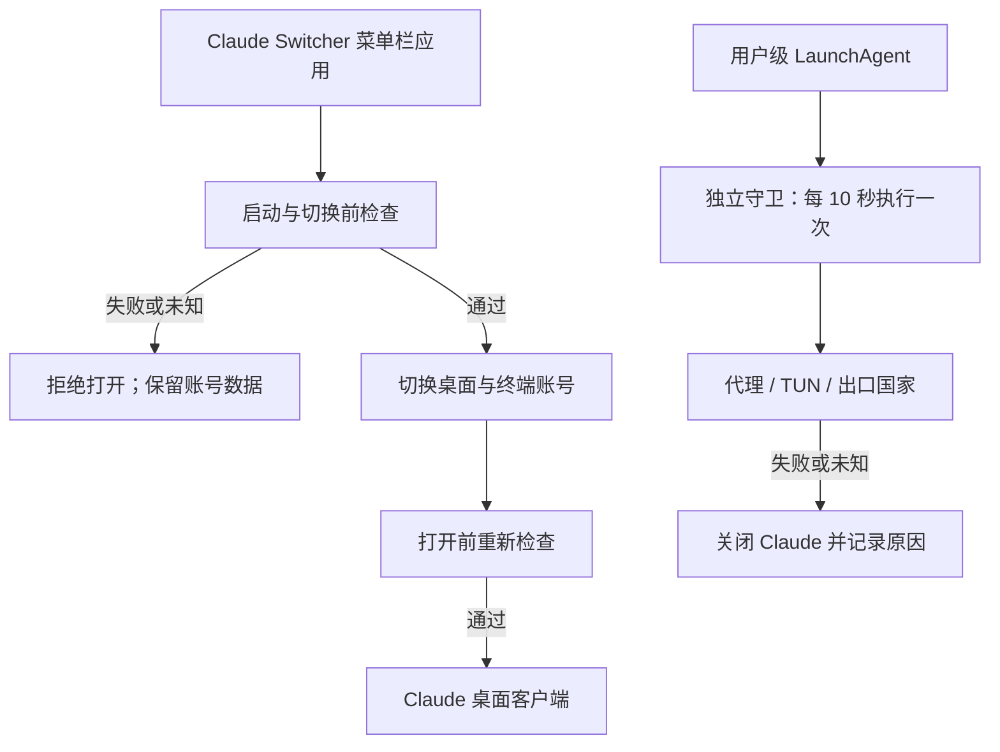

# Claude Switcher 整合设计

状态：开发中；本地分支 `codex/network-region-guard`。本文件描述目标，不代表已部署或真实账号验收。

## 目标与边界

基于 l2succes/claude-switcher 的 `011c00797c083530dc8cfa4557416cece86ab2b1` 开发。保留原有桌面账号切换、终端凭据同步和用量显示，用同一个应用管理启动前检查、独立后台守卫和会话复制。

本轮硬性检查只包括：代理连接、TUN 在线、出口国家符合用户明确配置。参考国家首次提供 SG，保存前不启用守卫。不把语言、地区格式、ASN 或 STUN 无响应作为启动门槛，不修改系统语言、时区、IPv6 或代理规则。

保护对象为本机 Claude **桌面客户端**。保留终端凭据同步，但不宣称已保护任意终端或 IDE 内的 Claude Code 进程。

## 运行结构

守卫是 App 包里的独立可执行文件，由当前用户的 launchd 管理，不使用 root，也不读其他应用的代理凭据。退出界面不卸载守卫。停止保护是独立、明确的操作；停止后界面显示未保护，切换器不再放行启动，直到重新启用。

launchd 检查是进程级急停，不是防火墙。网络探测有超时；异常发生到发现之间存在检查间隔和探测延迟。直接从 Finder 打开 Claude 不经过切换器的启动门禁，守卫只能在下次检查后关闭它。不能宣称零流量泄漏。

## 网络与地区判定

1. Shadowrocket 模式要求其 VPN 已连接，并存在本项目目前支持的 `198.18.*` TUN 地址；自动模式只识别同类 TUN，界面明确说明识别范围。
2. 通过 HTTPS 获取 Cloudflare trace，仅提取唯一的两位国家代码；超时、非 200、缺字段或无效字段均视为未知并阻断。
3. 目标国家必须为用户保存的两位大写代码。不得按本次异常出口自动修改目标。
4. 每次启动、切换、复制后重新打开 Claude 前都重新检查，不用用量缓存代替安全检查。
5. 守卫必须已注册且最近执行回执未过期；仅有服务文件或旧的通过结果不算守卫在线。
6. 回执只保存国家代码、原因、时间及急停结果，不保存公网 IP、代理地址、邮箱、账号 UUID、token 或会话内容。

Cloudflare trace 证明该探测请求的出口，不能单独证明 Claude 所有请求使用同一出口。仍依赖代理客户端的路由配置正确。本轮不自动改写代理路由或添加防火墙规则。

## 账号与文件安全

- 失败门禁发生在退出 Claude 和移动账号目录之前。
- 切换前完整退出 Claude，原有非空停放目录拒绝覆盖。
- 文件移动或当前账号标记写入失败时，尝试恢复切换前的目录；恢复失败明确保留恢复副本和路径，禁止继续打开 Claude。
- 桌面切换和终端凭据切换不是同一个事务。终端同步失败必须明确报告部分完成，不能显示两端都成功；不得静默继续启动。
- 不转换或删除 `Claude-Profiles`、另一个切换器的快照、现有登录或聊天历史。
- 开发、测试和演示不访问真实钥匙串、不真实切换账号、不终止真实 Claude。

## 会话复制

源端遍历 `claude-code-sessions/<account>/<org>/local_*.json`，不会只读第一个组织。UI 选择 ID 使用相对路径，防止不同组织的同名文件互相勾选。

目标账号优先使用 `config.json` 的 `lastKnownAccountUuid`。身份不明确时拒绝猜测；账号下有多个组织时让用户明确选择目标。复制保留新版本的未知 JSON 字段，移除已知账号专属连接、远程控制绑定和计划工作字段。

默认不覆盖已存在会话。同名且同一会话计为跳过；同名但会话身份不同报冲突。复制前校验整批输入，失败时回滚本批新建文件，源文件和共享 `~/.claude/projects` 历史不改动。只承诺本地 Code 会话索引复制，不承诺云端聊天迁移或自动合并。

## 安装、退出与卸载

- 开发产物与已安装应用分开；构建不会自动注册登录项或后台任务。
- 使用界面或命令明确启用保护后，保存配置并注册用户级 LaunchAgent。
- “退出界面，保留保护”与“停止保护”分开显示。修复、切换或复制过程中阻止退出，避免中断数据写入。
- 卸载脚本先停止并移除本应用的 LaunchAgent，不删除账号、钥匙串或会话；清理个人数据必须另行操作。
- 现有 `local.claude-bodyguard` 和时区服务暂不迁移或停用。新应用真机部署时再单独核对，避免同时运行两套守卫。

## 验收清单

| 项目 | 目标证据 | 当前状态 |
|---|---|---|
| 文档与 Git | 本地分支、开发说明、可回溯提交 | 开发中 |
| 网络决策 | 国家匹配、不同、未知、断线、TUN 缺失的隔离测试 | NOT_RUN |
| 启动门禁 | 失败时不退出、不移动、不启动的集成测试 | NOT_RUN |
| 后台急停 | 假进程停止动作及停用保护测试 | NOT_RUN |
| 生命周期 | 注册、退出界面、停止、卸载及过期回执测试 | NOT_RUN |
| 会话复制 | 多账号、多组织、冲突、未知字段、失败回滚 | NOT_RUN |
| 编译与 UI | 正式构建、演示账号界面、退出与重开 | NOT_RUN |
| 真实账号 A/B | 用户会话结束后的真机切换 | NOT_RUN |
| 实际断网与国家切换 | 用户可接受中断的真机验证 | NOT_RUN |

本轮只完成本地 Git，不向上游推送，不建立或发布远端仓库。
