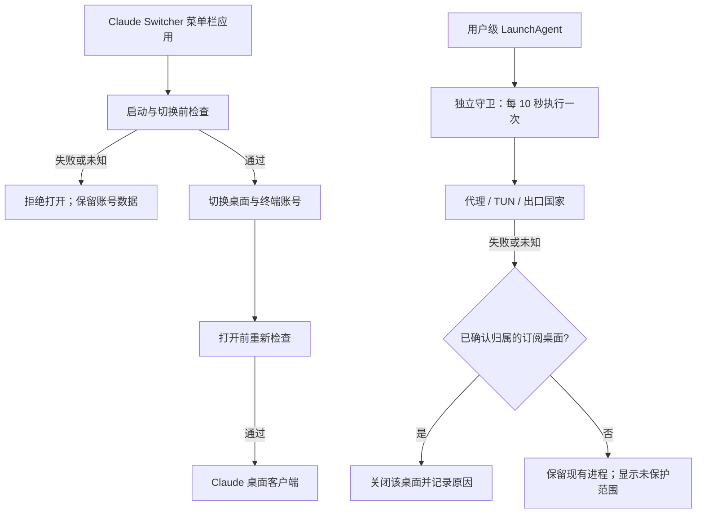

# Claude Switcher 整合设计

状态：local.5 核心开发候选；当前验证状态见 [功能对比说明](功能对比说明.html) 与 [开发记录](开发与验证.md)。以下本地版本记录保留历史；尚未部署和真实账号验收。会话迁移延期。本地分支 `codex/network-region-guard`。本文件描述目标，不代表已部署或真实账号验收。

## 目标与边界

基于 l2succes/claude-switcher 的 `011c00797c083530dc8cfa4557416cece86ab2b1` 开发。保留原有桌面账号切换、终端凭据同步和用量显示，用同一个应用管理启动前检查、独立后台守卫和会话复制。

本轮硬性检查只包括：代理连接、TUN 在线、出口国家符合用户明确配置。参考国家首次提供 SG，保存前不启用守卫。不把语言、地区格式、ASN 或 STUN 无响应作为启动门槛，不修改系统语言、时区、IPv6 或代理规则。

保护对象仅为本入口启动或用户明确确认的 **订阅桌面进程**。守护匹配 PID、启动时间和配置代次；API、未知和未确认的外部进程不自动纳入。保留默认 CLI 登录核验与显式同步，不绑定、停止或重启任意 CLI 长任务。

终端同步沿用上游的 Claude OAuth 登录凭据与 `oauthAccount`，不改 API key、环境变量或第三方 provider 设置，不等于订阅/API 模式迁移。读取权限失败或不认识的凭据格式必须中止，不能按“没有登录”处理。

## 运行结构

守卫是 App 包里的独立可执行文件，由当前用户的 launchd 管理，不使用 root，也不读其他应用的代理凭据。退出界面不卸载守卫。停止保护是独立、明确的操作；停止后界面显示未保护，切换器不再放行启动，直到重新启用。

launchd 检查是进程级急停，不是防火墙。网络探测有超时；异常发生到发现之间存在检查间隔和探测延迟。直接从 Finder 打开 Claude 不经过启动门禁，也不会被静默认领；需用户确认保护范围或保存工作后从本入口重新启动。不能宣称零流量泄漏。

## 网络与地区判定

1. Shadowrocket 模式要求其 VPN 已连接，并存在本项目目前支持的 `198.18.*` TUN 地址；自动模式只识别同类 TUN，界面明确说明识别范围。
2. 并行读取 claude.ai、api.anthropic.com、claude.com 的 HTTPS trace，三个域名都必须返回唯一的两位国家代码且彼此一致；超时、非 200、缺字段、无效字段或分流国家不一致均阻断。不用通用网站的出口代替 Claude 专线路由。
3. 目标国家必须为用户保存的两位大写代码。不得按本次异常出口自动修改目标。
4. 每次启动、切换、复制后重新打开 Claude 前都重新检查，不用用量缓存代替安全检查。
   切换器自身携带账号 token 的用量刷新、终端同步身份请求也必须先过门禁；保护未启用时只显示本地缓存，不发认证请求。
5. 守卫必须已注册且最近执行回执未过期；仅有服务文件或旧的通过结果不算守卫在线。
6. 回执只保存国家代码、原因、时间及急停结果，不保存公网 IP、代理地址、邮箱、账号 UUID、token 或会话内容。

三个主要 Claude 域名的 trace 能覆盖各自的实际域名路由，仍不能证明所有子域、每条连接和转发服务都采用同一出口，也不能替代防火墙。诊断端点若变化或不可用会按未知阻断，不回退到无关网站。本轮不自动改写代理路由或添加防火墙规则。

## 账号与文件安全

- 失败门禁发生在退出 Claude 和移动账号目录之前。
- 切换前完整退出 Claude，原有非空停放目录拒绝覆盖。
- 文件移动或当前账号标记写入失败时，尝试恢复切换前的目录；恢复失败明确保留恢复副本和路径，禁止继续打开 Claude。
- 正常联动先核验身份/组织与源、目标备份并回读，再退出桌面、移动目录、恢复默认 CLI 并回读。CLI 提交失败尝试恢复 CLI 归属字段与桌面目录；不是跨文件系统与钥匙串的崩溃原子事务。不能确认恢复时停止并保留数据。
- 准备阶段 CLI 无法确认时，只提供明确的“仅切桌面”例外：重新过门禁、路径和模式检查，不读写 CLI 登录或备份。该选择不在已进入提交/还原失败后提供；不自动降级、不冒称两端一致。
- 后台不写 CLI 凭据；用户从外部改号后，核验不一致提供同步到当前档案的补救按钮。目标无有效登录仍需官方 CLI 登录；不从桌面凭据生成 CLI 凭据。
- 不转换或删除 `Claude-Profiles`、另一个切换器的快照、现有登录或聊天历史。
- 开发、测试和演示不访问真实钥匙串、不真实切换账号、不终止真实 Claude。

## 会话复制（延期，原型未启用）

用户补充：优先完成核心，之后回查既有“订阅到订阅、订阅与 API 模式”迁移脚本。以下只作为索引原型的记录，不能当作迁移方案已确认。当前发行候选的复制入口与执行路径关闭；需先核对既有脚本、实际身份/组织索引、共享 transcript 及 API 模式差异，再决定是否复用本原型。

源端遍历 `claude-code-sessions/<account>/<org>/local_*.json`，不会只读第一个组织。UI 选择 ID 使用相对路径，防止不同组织的同名文件互相勾选。

目标账号优先使用 `config.json` 的 `lastKnownAccountUuid`。身份不明确时拒绝猜测；账号下有多个组织时让用户明确选择目标。复制保留新版本的未知 JSON 字段，移除已知账号专属连接、远程控制绑定和计划工作字段。

默认不覆盖已存在会话。同名且同一会话计为跳过；同名但会话身份不同报冲突。复制前校验整批输入，失败时回滚本批新建文件，源文件和共享 `~/.claude/projects` 历史不改动。只承诺本地 Code 会话索引复制，不承诺云端聊天迁移或自动合并。

## 安装、退出与卸载

- 开发产物与已安装应用分开；构建不会自动注册登录项或后台任务。
- 使用界面或命令明确启用保护后，保存配置并注册用户级 LaunchAgent。
- “退出界面，保留保护”与“停止保护”分开显示。修复、切换或复制过程中阻止退出，避免中断数据写入。
- 卸载脚本先停止并移除本应用的 LaunchAgent，不删除账号、钥匙串或会话；清理个人数据必须另行操作。
- 现有 `local.claude-bodyguard` 和时区服务暂不迁移或停用。新应用真机部署时再单独核对，避免同时运行两套守卫。

## 本地验证记录（2026-10-27）

| 项目 | 实际证据 | 当前状态 |
|---|---|---|
| 文档与 Git | 本地分支、开发说明、上游基线与可回溯提交 | 本地完成；未推送 |
| 网络决策 | 国家匹配/不同/未知、代理断线、TUN 缺失、ISO 代码校验 | 隔离测试 PASS |
| 启动门禁 | 第一次失败不准备、不启动；准备后国家改变不重新打开 | 隔离测试 PASS |
| 后台急停 | 假停止动作在异常时调用，关闭保护时不调用 | 隔离测试 PASS；实际急停 NOT_RUN |
| 独立运行 | App 内真实 helper、禁用保护的配置、临时用户 launchd 任务；无预览 UI 时连续产生回执，随后卸载 | PASS；未注册正式守卫 |
| 生命周期 | 模拟启停、旧服务冲突、回执过期、配置权限与卸载；演示窗口停止确认和退出 | PASS；正式启停 NOT_RUN |
| 终端登录归属 | 读失败或未知身份不按空登录处理；未知/不同归属拒绝备份 | 隔离测试 PASS；真实钥匙串切换 NOT_RUN |
| 会话迁移 | 索引原型 10 项测试通过，但产品入口与执行路径均关闭 | DEFERRED，需回查既有迁移脚本 |
| 编译与 UI | ARM64 Release 构建、warnings-as-errors、签名验证；静态演示与同一 Panel 的独立演示窗口 | PASS |
| 真实菜单栏弹层 | 锚点、多屏定位和实际登录状态 | NOT_RUN |
| 真实账号 A/B | 用户会话结束后的真机切换 | NOT_RUN |
| 实际断网与国家切换 | 用户可接受中断的真机验证 | NOT_RUN |

共 39 项隔离测试通过：29 项核心测试、10 项未启用的索引原型测试。只读的真实网络探测返回 SG，但不代表认证账号可用、正式守卫已在线或真实启动已经放行。

前端由本机 Kimi CLI 独立会话主做；主代理负责后端、集成审查，并修正退出提示的观察关系、演示模式边界及刷新期间的账号操作互斥。界面停止/恢复、非法国家输入、添加演示账号、12 账号滚动、国家不符时阻止打开/切换、退出等均用虚构数据验证。

真实守卫部署、旧服务迁移、真实钥匙串/账号切换、异常网络急停仍不在本地验证的完成范围。进程急停也不构成零流量泄漏保证。

本轮只完成本地 Git，不向上游推送，不建立或发布远端仓库。

## v1.3.0-local.2 收口边界

只调整保护状态读取和三处前端融合，不改变账号存储方案。守卫在线、网络允许和配置已启用分开；退出文案使用真实在线情况，目标国家使用已保存配置。前端由 Kimi CLI 修改。

39 项隔离测试及 7 项控制器状态检查通过；当前界面默认图已更新。原生交互复测因锁屏为 NOT_RUN_LOCKED，真实守护与切换验收仍未完成。新增 API/3P 使用约束与迁移脚本核查见 [专项分析](存储与迁移方案分析.md)，不在本轮自动实现或执行。
